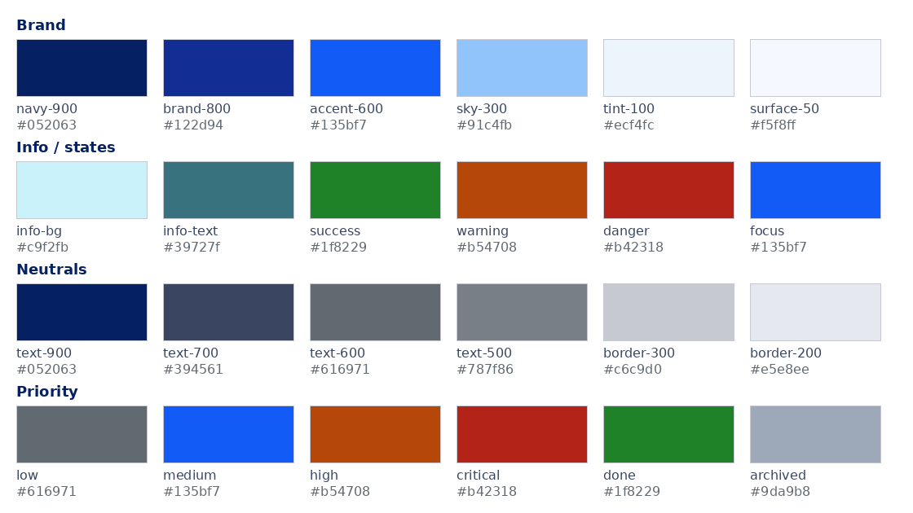
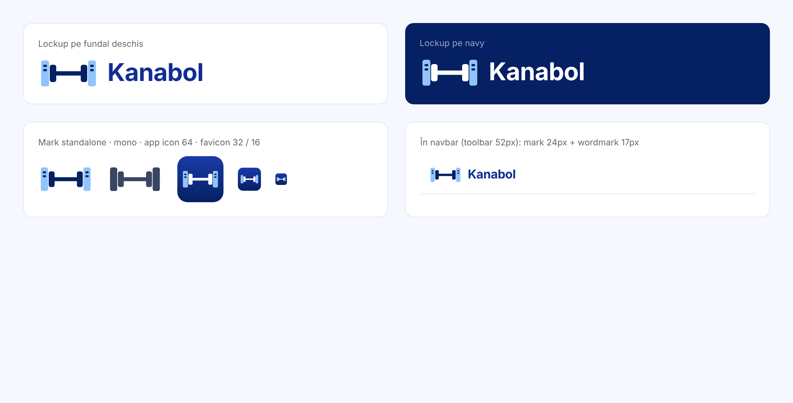

# UI/UX SPEC — Kanabol

> Specificație vizuală și de interacțiune pentru frontend-ul Angular 22 + Angular Material 22. Complementară cu `SPEC.md` (arhitectură); unde se contrazic, pentru vizual câștigă acest fișier.
>
> Stare: v1.20 — 2026-11-09 (v1.19 + deciziile grupului 19b după axe-core: `--kb-text-500` #697078 / #8692ae și `--kb-sky-300` #3b6cc7 în dark în §2.1, §2.2, §2.3 și §3.2 (de aplicat în grupul 20), meta și `caption` pe text-500 permise în §2.1 și §2.2, numele cardului în §7.4, overlay-urile Material ca excepție în §6.0.5 și §6.0.6, cum s-au implementat `prefers-reduced-motion` în §8 și landmark-urile în §9, verificarea din §15 bifată. v1.19 — 2026-11-09 (v1.18 + cum s-a implementat pagina de rapoarte în §7.8 (grupul 18), token-urile graficelor `--kb-chart-1` și `--kb-chart-2` în §2.1, §2.2, §2.3, §3.2 și §7.8 (grupul 19), verificarea UI din §15 detaliată în SPEC §13.5 (grupul 19b). v1.18 — 2026-11-09: v1.17 + cum s-au implementat panoul principal și pagina „Task-urile mele” în §7.2 (grupul 17a), și pagina de rapoarte cu tab-ul proiectului din grupul 18 în §7.8 și §7.3. v1.17 — 2026-11-08: v1.16 + cum s-au implementat clopoțelul, meniul și pagina notificărilor în §7.6 (grupul 17), și panoul principal cu pagina „Task-urile mele” din grupul 17a în §7.2. v1.16 — 2026-11-08: v1.15 + cum s-a implementat diferența descrierii în §7.5 (grupul 16b) și notificările grupului 17 în §7.6: badge-ul, meniul, textele compuse, pagina cu filtre. v1.15 — 2026-11-08: v1.14 + deciziile grupului 16 în §7.5: linia timeline-ului, stările goală și de eroare, recitirea; și diferența descrierii din grupul 16b în §7.5. v1.14 — 2026-11-08: v1.13 + deciziile grupului 15 în §6.3, §7.4 și §7.5: rândurile fișierelor din panou, comentariul editat pe loc, formularul cu `Ctrl+Enter`, tab-urile de 36px, board-ul la `CommentAdded` și `Attachments`; și timeline-ul istoricului din grupul 16 în §7.5. v1.13 — 2026-11-07: v1.12 + deciziile grupului 14 în §7.4: alunecarea cardului mutat de altcineva, așteptarea cât un card e în mână, `TaskArchived` fără pulsare. v1.12 — 2026-11-07: v1.11 + deciziile grupului 13b în §7.5: select-ul asignaților crește după nume, `Esc` închide doar lista, numele din istoric vin din API. v1.11 — 2026-11-07: v1.10 + mai mulți asignați pe un task în §7.3, §7.4, §7.5, §11 și §15, decis 2026-11-07; deciziile grupului 13 în §7.4: datele board-ului, „+ Task”, tastatura, filtrele și meniul coloanei. v1.10 — 2026-11-06: v1.9 + deciziile grupului 12: sortarea prin butoane proprii în §6.4, detaliile vederii „Listă” și rândul owner-ului dezactivat în §7.3, adresa, închiderea, deadline-ul și tab-urile panoului în §7.5. v1.9 — 2026-11-06: v1.8 + vederea „Listă” a proiectului în §7.3. v1.8 — 2026-11-06: v1.7 + deciziile grupului 11: lista, pagina proiectului, Membri și Setări în §7.3; `kb-segmented-nav` și `kb-filter-chip` la componentele din §15. v1.7 — 2026-11-06: v1.6 + deciziile grupului 10: select-ul cu săgeata lui Material ca excepție în §6.0.4; chip-urile de stare ale utilizatorului și „Arhivat” pe text-600 în §6.5; stările, meniul ⋮ și sheet-urile utilizatorilor în §7.7. v1.6 — 2026-11-06: v1.5 + deciziile grupului 9: ce Material 22 nu expune prin token rămâne cum e, ca excepții în §6.0.3, §6.0.5, §6.0.6, §8 și §13; chip-urile neutre și skeleton-ul ca amestec în §6.5 și §6.8; `--kb-on-ink-accent` pentru acțiunea snackbar-ului în §2.3, §2.4 și §6.2; `--kb-logo-bar` și `--kb-logo-disc` pentru lockup în §2.3, §2.4 și §14.4; repetarea parolei și ieșirea din cont în §7.1. v1.5 — 2026-11-05: v1.4 + lectura cap-coadă: `--kb-ink` pentru tooltip și snackbar în dark, animația meniurilor în §8, zona de click a butoanelor-iconiță în §3.3, §6.4 și §9, căutarea globală scoasă din v1, tab „Rapoarte” pe proiect în §7.3, markdown sanitizat în §7.5, mărunțișuri în §0, §2.3, §6.0.4, §7.4, §13). Tema derivă din culorile aplicației interne existente la firmă (screenshot „SDG Platformă Web”, eșantionat pixel cu pixel), ca trecerea colegilor la Kanabol să fie familiară. Ce era inconsistent acolo e corectat aici, nu copiat. **Forma** (colțuri, borduri, umbre, dialoguri, controale) urmează limbajul aplicațiilor macOS — nu culorile lui, ci proporțiile și materialele.



---

## 0. Rezumat

| Subiect | Decizie |
|---|---|
| Direcție | „Enterprise calm, formă macOS”: alb + albastru-marin, fundal foarte deschis, accente albastre vii; colțuri rotunjite generos, borduri fine cu highlight, umbre moi stratificate, translucență pe sidebar/meniuri |
| Paletă | 6 culori de brand + 4 de stare + neutre; toate ca CSS custom properties `--kb-*` și ca temă Material M3 |
| Buton implicit (default) | **fill-accent `#135bf7` plin, text alb, gradient subtil** — ca butonul „default” din macOS. *(schimbat față de v1.0; sky-300 trece la selecție/highlight)* |
| Buton secundar (bezel) | alb, bordură `border-300`, umbră 1px — butonul standard macOS |
| Link / activ / focus | accent-600 `#135bf7`; focus = halo 4px semitransparent |
| Font | Inter (self-hosted `@fontsource-variable/inter`), 13px bază în controale, 14px în text, tracking ușor negativ pe titluri |
| Spațiere | scară de 4px: 4 / 8 / 12 / 16 / 24 / 32 / 48 |
| Rază colțuri | 6px controale, 8px carduri mici/chips pătrate, 10px carduri, 12px dialoguri/sheets/popovers, 999px pill |
| Layout | navbar 52px (toolbar translucid), sidebar 240px source-list (colapsabil la 56px), conținut max 1440px |
| Densitate Material | `-1` (compact) |
| Dark mode | suportat prin `prefers-color-scheme` + toggle manual; aceeași semantică de tokens |
| Iconițe | Material Symbols Outlined, self-hosted, greutate 400; 16px în controale, 20px în liste, 48px în empty states (§12) |
| Logo | **Ganteră cu discuri-carduri** (concept #02), mark + wordmark „Kanabol” în Inter 700; fișiere în `Atasamente/logo/` și `frontend/public/brand/` (§14) |
| Limbă | UI în română, sentence case, fără majuscule decorative |

---

## 1. Principii

1. **Familiar, nu identic.** Aceeași familie de culori ca softul actual, ca să nu pară „un alt tool de învățat”. Dar: aliniere consistentă, spațiere regulată, un singur stil de buton primar, fără controale native nestilizate.
2. **Densitate de lucru.** Utilizatorii stau în aplicație ore întregi; preferăm mai multă informație pe ecran și mai puțin padding decât default-ul Material.
3. **Starea e vizibilă.** Orice acțiune are feedback în < 100 ms (optimistic update + snackbar); orice listă are stare de încărcare, goală și de eroare proiectată, nu improvizată.
4. **Tastatura contează.** Tot ce se face cu mouse-ul se face și cu tastatura, inclusiv mutarea cardurilor pe kanban.
5. **Culoarea nu e singurul semnal.** Prioritatea, starea și erorile au și iconiță sau text.

---

## 2. Tokens de culoare

### 2.1 Paleta (light)

| Token | Hex | Sursă în screenshot | Folosire |
|---|---|---|---|
| `--kb-navy-900` | `#052063` | titlu „Platformă Web”, h1 „Panou principal” | titluri, text pe butoanele bezel, text puternic |
| `--kb-brand-800` | `#122d94` | logo SDG | logo, navbar brand; graficele au token-urile lor, `--kb-chart-1` și `-2` (grupul 19) |
| `--kb-accent-600` | `#135bf7` | clopoțel + badge notificări | link-uri, element activ în sidebar, focus ring, iconițe interactive, badge-uri |
| `--kb-sky-300` | `#91c4fb` | butoanele „Încarcă fișier”, „Actualizare…” | selecție pe kanban, highlight rând, chip „Owner”; nu e fundal de buton: butonul default e `--kb-fill-accent` (§3.3) |
| `--kb-tint-100` | `#ecf4fc` | fundal element activ sidebar | hover/activ în liste și meniuri, fundal chip neutru |
| `--kb-surface-50` | `#f5f8ff` | fundalul paginii | fundal aplicație |
| `--kb-surface-0` | `#ffffff` | carduri, navbar, sidebar | carduri, dialoguri, tabele, câmpuri |
| `--kb-info-bg` | `#c9f2fb` | bannerele cyan | banner informativ |
| `--kb-info-text` | `#39727f` | textul din bannere | text în banner informativ |
| `--kb-success-600` | `#1c7a26` | „+” verde din sidebar (`#1f8229`), închis puțin ca să treacă AA pe `success-bg` | stare „done”, confirmări, chips succes |
| `--kb-warning-600` | `#b54708` | — (adăugat) | prioritate High, avertismente, deadline apropiat |
| `--kb-danger-600` | `#b42318` | — (adăugat) | prioritate Critical, erori, deadline depășit, acțiuni distructive |
| `--kb-text-900` | `#052063` | = navy | titluri |
| `--kb-text-700` | `#394561` | text sidebar | text principal (body) |
| `--kb-text-600` | `#616971` | etichetele „Nume utilizator:” | text secundar, etichete |
| `--kb-text-500` | `#697078` | valorile gri (era `#787f86`, 4,1:1 pe alb; schimbat 2026-11-09 după axe-core, de aplicat în grupul 20) | placeholder, text dezactivat, meta și `caption` (4,5:1 pe alb, 4,5–5,0:1 pe sidebar, zebra și rând necitit) |
| `--kb-border-300` | `#c6c9d0` | linia hr | borduri câmpuri, separatoare puternice |
| `--kb-border-200` | `#e5e8ee` | — (derivat) | borduri carduri, linii tabel |
| `--kb-archived-400` | `#9da9b8` | iconițe sidebar inactive | iconițe inactive, task arhivat |
| `--kb-chart-1` | `#122d94` | = brand-800 | seria principală a graficelor din rapoarte (§7.8; grupul 19, decis 2026-11-09) |
| `--kb-chart-2` | `#135bf7` | = accent-600 | a doua serie a graficelor; ΔE 19 față de prima |

Fundaluri de stare (derivate, pentru chips/bannere): `--kb-success-bg #e6f4e8`, `--kb-warning-bg #fdf0e6`, `--kb-danger-bg #fbe9e7`.

Fundaluri pline sub text alb: `--kb-fill-accent #135bf7` și `--kb-fill-danger #b42318`, pentru butoanele default și distructiv, hover în meniu, rând selectat, chip de filtru activ, badge și checkbox bifat. `--kb-fill-shade #052063` le închide la hover, la apăsare și pe bordură. Sunt aceleași în light și dark. Textul alb nu stă niciodată direct pe `accent-600` sau `danger-600`, care devin deschise în dark.

### 2.2 Perechi verificate WCAG (contrast)

| Text | Fundal | Raport | Verdict |
|---|---|---|---|
| navy `#052063` | alb | 15.1 | AAA |
| navy `#052063` | sky-300 `#91c4fb` (selecție, highlight, chip „Owner”) | 8.3 | AAA |
| alb | sky-300 `#91c4fb` | 1.8 | ✗ interzis |
| chart-1 / chart-2 (bare) | cardul: alb în light, `#161f36` în dark | 11.5 / 5.4 în light; 9.0 / 3.4 în dark | peste 3:1, destul pentru bare (non-text); sky-300 avea 1.8 pe alb și brand-800 1.4 pe cardul din dark (grupul 19) |
| accent `#135bf7` | alb | 5.4 | AA — ok pentru link-uri și iconițe |
| accent `#135bf7` | tint-100 `#ecf4fc` | 4.9 | AA — element activ în sidebar |
| alb | fill-accent `#135bf7` | 5.4 (4.8 în vârful gradientului) | AA — badge-uri, buton default plin, în light și dark |
| alb | fill-danger `#b42318` | 6.6 (5.8 în vârful gradientului) | AA — buton distructiv plin, în light și dark |
| text-700 `#394561` | alb | 9.6 | AAA |
| text-600 `#616971` | alb | 5.6 | AA |
| text-500 `#697078` | alb | 4.5 | meta și `caption` la 12–13px (sidebar 4,9, zebra 4,7, rând necitit 4,5; era `#787f86`, 4,1:1, doar ≥ 14px bold sau ≥ 18px; schimbat 2026-11-09) |
| info-text `#39727f` | info-bg `#c9f2fb` | 4.5 | AA (la limită: nu folosi font < 14px în bannere) |
| success `#1c7a26` / danger `#b42318` / warning `#b54708` | alb | 5.4 / 6.6 / 5.4 | AA |
| success `#1c7a26` / danger `#b42318` / warning `#b54708` | fundalul de stare al fiecăreia | 4.8 / 5.6 / 4.9 | AA |

Albastrul deschis al link-urilor din aplicația veche (`#4a8ee6`, 3.3:1) **nu** e preluat — pică AA.

### 2.3 Dark mode

Aceiași tokens semantici, valori diferite. Nu inversăm pur și simplu; păstrăm albastrul ca accent și dăm fundaluri navy-gri.

| Token | Dark |
|---|---|
| `--kb-surface-50` (fundal app) | `#0f1629` |
| `--kb-surface-0` (carduri) | `#161f36` |
| `--kb-tint-100` (hover/activ) | `#1e2a4a` |
| `--kb-border-200` / `-300` | `#273252` / `#344166` |
| `--kb-text-900` | `#eef2ff` |
| `--kb-text-700` | `#cdd5e8` |
| `--kb-text-600` | `#9aa6c2` |
| `--kb-text-500` | `#8692ae` (era `#6f7b96`, 3,3–4,0:1 la 12–13px; acum 4,5–5,8:1 pe `#161f36`, `#141c32`, `#1c253c` și `#1e2a4a`; schimbat 2026-11-09, de aplicat în grupul 20) |
| `--kb-accent-600` | `#5b93ff` (mai deschis, 5.5:1 pe `#161f36`) |
| `--kb-fill-accent` / `--kb-fill-danger` / `--kb-fill-shade` | la fel ca în light: `#135bf7` / `#b42318` / `#052063` (textul alb ar avea doar 3.0:1 pe accentul din dark și 2.8:1 pe danger) |
| `--kb-sky-300` (selecție, highlight) | `#3b6cc7` cu text `#eef2ff` (4,5:1 la 12px pe chip-ul „Owner”; era `#3d6fc9`, 4,35:1; schimbat 2026-11-09, de aplicat în grupul 20; `--kb-chart-2` rămâne `#3d6fc9`) |
| `--kb-info-bg` / `--kb-info-text` | `#113a45` / `#9fdcea` |
| success / warning / danger | `#4ade80` / `#fbbf24` / `#f87171` pe fundaluri `#0f2a16` / `#2d1f05` / `#2d0f0d` |
| `--kb-archived-400` | `#55617d` |
| `--kb-chart-1` / `--kb-chart-2` | `#91c4fb` / `#3d6fc9`: barele graficelor, peste 3:1 pe `#161f36`, ΔE 25 între ele (grupul 19) |
| `--kb-ink` | la fel ca în light, `#052063`: fundalul tooltip-urilor și al snackbar-ului, care au text alb în ambele teme (`navy-900` nu se poate folosi acolo, devine aproape alb în dark) |
| `--kb-on-ink-accent` | la fel ca în light, `#91c4fb`: acțiunile și linkurile de pe `--kb-ink` (snackbar); `sky-300` ar avea doar 3:1 acolo în dark |
| `--kb-logo-bar` / `--kb-logo-disc` | `#ffffff` / `#91c4fb`: lockup-ul din navbar, ca `kanabol-mark-on-dark.svg` (§14.4); culori de brand, nu de temă |

Activare: `@media (prefers-color-scheme: dark)` + `html[data-theme="dark"]`; toggle în meniul utilizatorului, memorat în `localStorage` (`kb.theme`). Material primește `color-scheme: light dark` și își schimbă tokens-urile sincron.

### 2.4 Fișierul de tokens

`src/styles/_tokens.scss`:

```scss
:root {
  --kb-navy-900: #052063;
  --kb-brand-800: #122d94;
  --kb-accent-600: #135bf7;
  --kb-sky-300: #91c4fb;
  --kb-tint-100: #ecf4fc;
  --kb-surface-50: #f5f8ff;
  --kb-surface-0: #ffffff;
  --kb-info-bg: #c9f2fb;
  --kb-info-text: #39727f;
  --kb-success-600: #1c7a26;
  --kb-success-bg: #e6f4e8;
  --kb-warning-600: #b54708;
  --kb-warning-bg: #fdf0e6;
  --kb-danger-600: #b42318;
  --kb-danger-bg: #fbe9e7;
  --kb-text-900: #052063;
  --kb-text-700: #394561;
  --kb-text-600: #616971;
  --kb-text-500: #697078;
  --kb-border-300: #c6c9d0;
  --kb-border-200: #e5e8ee;
  --kb-archived-400: #9da9b8;

  /* Fundaluri pline sub text alb. Rămân la fel în dark, unde accent-600 și danger-600 devin deschise. */
  --kb-fill-accent: #135bf7;
  --kb-fill-danger: #b42318;
  --kb-fill-shade: #052063; /* le închide la hover, la apăsare și pe bordură */
  --kb-ink: #052063; /* fundal închis sub text alb în ambele teme: tooltip, snackbar */
  --kb-on-ink-accent: #91c4fb; /* acțiuni și linkuri pe --kb-ink, la fel în dark */

  /* Graficele rapoartelor (§7.8): seria principală și a doua, peste 3:1 pe card în ambele teme */
  --kb-chart-1: #122d94;
  --kb-chart-2: #135bf7;

  /* Lockup-ul din navbar: culorile mark-ului (§14.4), nu ale temei */
  --kb-logo-bar: #052063;
  --kb-logo-disc: #91c4fb;

  /* Focus: halo mac-like, 4px, semitransparent */
  --kb-focus-ring: 0 0 0 4px color-mix(in srgb, var(--kb-accent-600) 30%, transparent);

  /* Umbre stratificate (ambient + contact), ca ferestrele/popover-urile mac */
  --kb-shadow-bezel: 0 0.5px 1px rgba(5, 32, 99, 0.10), 0 1px 2px rgba(5, 32, 99, 0.06);
  --kb-shadow-1: 0 1px 2px rgba(5, 32, 99, 0.06), 0 2px 6px rgba(5, 32, 99, 0.05);
  --kb-shadow-2: 0 2px 6px rgba(5, 32, 99, 0.08), 0 8px 24px rgba(5, 32, 99, 0.10);
  --kb-shadow-popover: 0 0 0 0.5px rgba(5, 32, 99, 0.12), 0 4px 10px rgba(5, 32, 99, 0.10), 0 16px 40px rgba(5, 32, 99, 0.14);
  --kb-shadow-sheet: 0 0 0 0.5px rgba(5, 32, 99, 0.12), 0 12px 32px rgba(5, 32, 99, 0.18), 0 32px 80px rgba(5, 32, 99, 0.16);
  --kb-shadow-drag: 0 12px 28px rgba(5, 32, 99, 0.22), 0 2px 6px rgba(5, 32, 99, 0.12);

  /* Highlight interior pe controale (linia de 1px mai deschisă de sus, ca bezel-ul mac) */
  --kb-inner-highlight: inset 0 1px 0 rgba(255, 255, 255, 0.6);
  --kb-inner-highlight-on-accent: inset 0 1px 0 rgba(255, 255, 255, 0.22);

  /* Materiale translucide (sidebar, navbar, meniuri) */
  --kb-glass-bg: rgba(255, 255, 255, 0.72);
  --kb-glass-blur: saturate(180%) blur(20px);

  --kb-radius-xs: 4px;    /* checkbox, badge-uri mici */
  --kb-radius-sm: 6px;    /* butoane, câmpuri, selecție în sidebar */
  --kb-radius-md: 10px;   /* carduri, grupuri de formular */
  --kb-radius-lg: 12px;   /* dialoguri, sheets, popovers, meniuri */
  --kb-radius-pill: 999px;

  --kb-space-1: 4px; --kb-space-2: 8px; --kb-space-3: 12px; --kb-space-4: 16px;
  --kb-space-6: 24px; --kb-space-8: 32px; --kb-space-12: 48px;

  --kb-navbar-h: 52px;
  --kb-sidebar-w: 240px;
  --kb-sidebar-w-collapsed: 56px;
  --kb-content-max: 1440px;

  --kb-font: 'Inter Variable', Inter, system-ui, -apple-system, 'Segoe UI', Roboto, sans-serif;
  --kb-font-mono: ui-monospace, 'Cascadia Code', Consolas, monospace;

  --kb-dur-fast: 120ms; --kb-dur-base: 200ms; --kb-dur-slow: 320ms;
  --kb-ease: cubic-bezier(0.2, 0, 0, 1);
}

@mixin dark {
  --kb-surface-50: #0f1629;  --kb-surface-0: #161f36;  --kb-tint-100: #1e2a4a;
  --kb-border-200: #273252;  --kb-border-300: #344166;
  --kb-text-900: #eef2ff;    --kb-text-700: #cdd5e8;   --kb-text-600: #9aa6c2;  --kb-text-500: #8692ae;
  --kb-accent-600: #5b93ff;  --kb-sky-300: #3b6cc7;    --kb-navy-900: #eef2ff;
  --kb-info-bg: #113a45;     --kb-info-text: #9fdcea;
  --kb-success-600: #4ade80; --kb-success-bg: #0f2a16;
  --kb-warning-600: #fbbf24; --kb-warning-bg: #2d1f05;
  --kb-danger-600: #f87171;  --kb-danger-bg: #2d0f0d;
  --kb-archived-400: #55617d;
  --kb-chart-1: #91c4fb;   --kb-chart-2: #3d6fc9;
  --kb-logo-bar: #ffffff;
  --kb-shadow-bezel: 0 0.5px 1px rgba(0,0,0,.5), 0 1px 2px rgba(0,0,0,.3);
  --kb-shadow-1: 0 1px 2px rgba(0,0,0,.4), 0 2px 6px rgba(0,0,0,.3);
  --kb-shadow-2: 0 2px 6px rgba(0,0,0,.4), 0 8px 24px rgba(0,0,0,.5);
  --kb-shadow-popover: 0 0 0 0.5px rgba(255,255,255,.12), 0 4px 10px rgba(0,0,0,.4), 0 16px 40px rgba(0,0,0,.5);
  --kb-shadow-sheet: 0 0 0 0.5px rgba(255,255,255,.14), 0 12px 32px rgba(0,0,0,.5), 0 32px 80px rgba(0,0,0,.5);
  --kb-inner-highlight: inset 0 1px 0 rgba(255,255,255,.08);
  --kb-glass-bg: rgba(22, 31, 54, 0.72);
}
@media (prefers-color-scheme: dark) { :root:not([data-theme='light']) { @include dark; } }
:root[data-theme='dark'] { @include dark; }
```

Regula: **componentele folosesc doar `var(--kb-*)`**, niciodată hex direct. Material își ia culorile din temă (§3); restul UI-ului din tokens.

---

## 3. Tema Angular Material 22 (M3)

### 3.1 Generare paletă

O singură dată, din `frontend/`:

```sh
ng generate @angular/material:theme-color \
  --primaryColor=#122d94 --secondaryColor=#135bf7 --tertiaryColor=#1f8229 \
  --neutralColor=#616971 --errorColor=#b42318 \
  --directory=src/styles/theme
```

Produce `src/styles/theme/_theme-colors.scss` cu `$primary-palette`, `$tertiary-palette`. Fișierul e generat și **nu se editează manual**; nuanțele exacte de brand se forțează prin overrides.

### 3.2 `src/styles.scss`

```scss
@use '@angular/material' as mat;
@use './styles/theme/theme-colors' as kb;
@use './styles/tokens';
@use '@fontsource-variable/inter';
@use 'material-symbols/outlined.css';

html {
  color-scheme: light dark;
  @include mat.theme((
    color: (primary: kb.$primary-palette, tertiary: kb.$tertiary-palette, theme-type: color-scheme),
    typography: (plain-family: var(--kb-font), brand-family: var(--kb-font), bold-weight: 600, medium-weight: 500, regular-weight: 400),
    density: -1,
  ));

  // Aliniem system tokens Material la brand (light; dark-ul vine din paleta generată)
  @include mat.theme-overrides((
    surface: var(--kb-surface-0),
    surface-container-lowest: var(--kb-surface-0),
    surface-container-low: var(--kb-surface-50),
    surface-container: var(--kb-tint-100),
    outline-variant: var(--kb-border-200),
    outline: var(--kb-border-300),
    on-surface: var(--kb-text-700),
    on-surface-variant: var(--kb-text-600),
    primary: var(--kb-accent-600),
    primary-container: var(--kb-sky-300),
    on-primary-container: var(--kb-navy-900),
    corner-small: var(--kb-radius-sm),
    corner-medium: var(--kb-radius-md),
    corner-large: var(--kb-radius-md),
  ));

  // Butoane mac-like: "filled" = default (fill-accent + alb), "outlined" = bezel (alb + bordură + umbră)
  @include mat.button-overrides((
    filled-container-color: var(--kb-fill-accent),
    filled-label-text-color: #ffffff,
    filled-container-shape: var(--kb-radius-sm),
    filled-container-height: 32px,
    outlined-container-shape: var(--kb-radius-sm),
    outlined-container-height: 32px,
    outlined-outline-color: var(--kb-border-300),
    outlined-label-text-color: var(--kb-text-900),
    text-container-shape: var(--kb-radius-sm),
    text-label-text-color: var(--kb-accent-600),
  ));
  @include mat.card-overrides((elevated-container-color: var(--kb-surface-0), elevated-container-shape: var(--kb-radius-md), outlined-outline-color: var(--kb-border-200), outlined-container-shape: var(--kb-radius-md)));
  @include mat.dialog-overrides((container-shape: var(--kb-radius-lg), container-color: var(--kb-surface-0)));
  @include mat.menu-overrides((container-shape: var(--kb-radius-lg), container-color: var(--kb-surface-0)));
  @include mat.form-field-overrides((outlined-outline-color: var(--kb-border-300), outlined-focus-outline-color: var(--kb-accent-600), outlined-container-shape: var(--kb-radius-sm), container-text-size: 13px, container-height: 32px));
  @include mat.slide-toggle-overrides((selected-track-color: var(--kb-accent-600), track-shape: var(--kb-radius-pill)));
  @include mat.sidenav-overrides((container-background-color: var(--kb-surface-0), container-divider-color: var(--kb-border-200)));
  @include mat.toolbar-overrides((container-background-color: var(--kb-surface-0), container-text-color: var(--kb-navy-900)));
}

html, body { height: 100%; margin: 0; }
body {
  font-family: var(--kb-font); font-size: 14px; line-height: 1.5;
  color: var(--kb-text-700); background: var(--kb-surface-50);
  -webkit-font-smoothing: antialiased;
}
a { color: var(--kb-accent-600); text-decoration: none; }
a:hover { text-decoration: underline; }
:focus-visible { outline: none; box-shadow: var(--kb-focus-ring); border-radius: var(--kb-radius-sm); }
```

Pachete: `@angular/material`, `@angular/cdk`, `@fontsource-variable/inter`, `material-symbols`. Nimic de la Google Fonts/CDN — aplicația rulează în LAN.

### 3.3 Mapare butoane Material → roluri

| Rol | Directivă Material | Aspect (detalii în §6.0.3) |
|---|---|---|
| Default (o singură dată pe dialog/zonă; răspunde la `Enter`) | `matButton="filled"` | fill-accent cu gradient subtil, text alb, highlight interior |
| Bezel / standard | `matButton="outlined"` + clasă `kb-bezel` | alb, bordură border-300, umbră bezel, text navy |
| Text / inline | `matButton` | text accent-600, fără bordură, hover fundal tint-100 |
| Distructiv | `matButton="filled"` + clasă `kb-danger` | fill-danger cu același tratament ca default; **mereu** după dialog de confirmare |
| Iconiță (toolbar) | `matIconButton` | vizual 28×28 în toolbar, 32×32 în conținut, cu zona de click mereu minim 40×40 prin padding transparent (§9); fundal transparent, hover fundal tint-100, rază 6px |

Nu folosim `matButton="elevated"` sau `"tonal"` — un singur limbaj de butoane.

---

## 4. Tipografie

Inter Variable, self-hosted. Scală (size / line-height / weight):

| Stil | Mărime | Folosire |
|---|---|---|
| `kb-display` | 24 / 32 / 600, navy | titlul paginii (h1), unul per pagină |
| `kb-title` | 18 / 26 / 600, navy | titlu card, titlu dialog (h2) |
| `kb-subtitle` | 15 / 22 / 600, text-700 | titlu secțiune în card, coloană kanban (h3) |
| `kb-body` | 14 / 21 / 400, text-700 | text standard, celule tabel, câmpuri |
| `kb-body-strong` | 14 / 21 / 600 | etichete („Nume utilizator:”), nume task pe card |
| `kb-caption` | 12 / 16 / 400, text-600 | meta (date, autor), breadcrumb, header tabel (uppercase **nu**) |
| `kb-mono` | 13 / 20, mono | ID-uri, coduri de eroare (correlation id) |

Reguli: sentence case peste tot („Actualizare conturi”, nu „Actualizare Conturi”); fără `letter-spacing` pe text normal; numerele în tabele cu `font-variant-numeric: tabular-nums`; truncare cu `text-overflow: ellipsis` + tooltip cu textul complet.

---

## 5. Layout

```
┌──────────────────────────────────────────────────────────────┐
│ toolbar 52px, translucid: [≡] [logo Kanabol]                 [🔔3] [◯ email ▾] │
├──────────┬───────────────────────────────────────────────────┤
│ source   │ page header: h1 + breadcrumb        [acțiune default] │
│ list     │───────────────────────────────────────────────────│
│ 240px    │ conținut (max 1440px, padding 24px)                │
│ glass    │   carduri plate / tabel zebra / board              │
│ items    │                                                    │
│ 28px     │                                                    │
└──────────┴───────────────────────────────────────────────────┘
```

- **Navbar (toolbar)**: vezi §6.0.8. Stânga: buton colapsare sidebar (iconiță `dock_to_left`), logo = lockup din §14 (mark 24px înălțime + wordmark „Kanabol” în brand-800, 17px/700, tracking −0.015em, gap 8px), link spre Panou principal. Dreapta: clopoțel cu badge, meniu utilizator. Căutarea globală (`Ctrl+K`) nu e în v1; board-ul are căutare locală după titlu (§7.4).
- **Sidebar (source list)**: vezi §6.0.7. Grupuri: „Lucru” (Panou principal, Proiectele mele, Task-urile mele, Notificări), „Administrare” (Utilizatori, Roluri, Rapoarte — vizibile doar cu permisiune), jos: versiune (`caption`, text-500). Stare memorată în `localStorage` (`kb.sidebar`).
- **Page header**: h1 `kb-display`, sub el breadcrumb (`caption`, „Acasă › Proiecte › Kanabol v1”, separator `›`, ultimul element text-700 fără link). În dreapta, pe aceeași linie cu h1, butonul default al paginii (ex. „Task nou”) și, opțional, un segmented control (Board / Listă). Padding 24px 24px 16px.
- **Conținut**: fundal surface-50, padding 0 24px 24px, `max-width: var(--kb-content-max)`, centrat. Board-ul kanban ignoră max-width (full-bleed cu scroll orizontal).
- **Card**: vezi §6.0.10. Padding 20px 24px. Titlu `kb-title`, 16px sub el conținutul. Carduri într-o pagină: spațiu 16px între ele.

Corectări față de aplicația veche vizibile în screenshot: butoanele nu mai „plutesc” distribuite pe lățime (stau grupate stânga, 8px între ele); nu mai folosim `<input type="file">` nativ (zonă de drop stilizată); bannerele informative nu mai apar între secțiuni ca separatoare — informația merge în subtitlul secțiunii.

---

## 6. Componente

### 6.0 Limbaj de formă (macOS-like)

Ce luăm din macOS: proporțiile controalelor, colțurile, bordurile fine cu highlight, umbrele stratificate, translucența, sheet-urile și popover-urile. Ce **nu** luăm: fontul SF, culorile sistemului, butoanele „semafor”, iconografia SF Symbols. Rezultatul trebuie să fie recognoscibil ca Kanabol (paleta din §2), dar să se simtă ca o aplicație nativă.

#### 6.0.1 Reguli generale

1. **Colțuri**: 6px pe controale (butoane, câmpuri, selecție în liste), 10px pe carduri și grupuri, 12px pe dialoguri, sheets, popovers, meniuri. Colțurile sunt mereu **concentrice**: un element cu padding `p` în interiorul unui container cu rază `R` are raza `R − p` (minim 4px). Niciodată colț drept pe un element care plutește.
2. **Borduri**: 1px (0.5px pe ecrane HiDPI prin `border-width: 0.5px` unde browserul suportă) în `border-300` pe controale, `border-200` pe carduri și separatoare. Controalele albe au în plus `--kb-inner-highlight` (linie de 1px mai deschisă sus) — asta dă efectul de „bezel” macOS.
3. **Umbre**: stratificate, mereu două–trei layere (contact + ambient), colorate cu navy semitransparent, nu negru. Un element plat (card în pagină) **nu** are umbră; umbra înseamnă „plutește” (meniu, popover, sheet, card tras). Cu cât plutește mai sus, cu atât umbra e mai mare și mai difuză (`shadow-bezel` → `shadow-1` → `shadow-2` → `shadow-popover` → `shadow-sheet`).
4. **Materiale**: navbar, sidebar și meniurile sunt translucide (`--kb-glass-bg` + `backdrop-filter: var(--kb-glass-blur)`), cu fallback opac dacă `backdrop-filter` lipsește. Conținutul (carduri, tabele, dialoguri) e opac.
5. **Gradient subtil doar pe butonul default și pe cel distructiv**: `linear-gradient(180deg, color-mix(in srgb, X 92%, white) 0%, X 100%)` — 8% mai deschis sus, imperceptibil conștient, vizibil ca „volum”. Nicăieri altundeva gradienturi.
6. **Mărimi**: controalele au 3 mărimi — `small` 24px (în tabele, chips de filtru), `regular` 28px (toolbar, formulare dense), `large` 32px (butoanele principale ale unui formular/dialog). Default-ul în aplicație e **regular 28px**; Material e configurat pe 32px (`large`) și reducem cu clasa `kb-sm`/`kb-regular`.
7. **Text în controale**: 13px/500 la `regular` și `large`, 12px/500 la `small`. Etichetele de butoane sunt scurte (1–3 cuvinte), cu verb.
8. **Hover e discret, press e vizibil**: hover = fundal cu 4–6% navy peste; press (`:active`) = fundal cu 10% navy peste + `transform: translateY(0.5px)`; nu animăm `scale` pe butoane.
9. **Focus**: halo semitransparent 4px (`--kb-focus-ring`), colțurile halo-ului urmează colțul controlului. Apare doar la `:focus-visible`.
10. **Dezactivat**: opacitate 0.45 pe tot controlul, fără schimbare de culoare, cursor `default` (nu `not-allowed`).

#### 6.0.2 Clase utilitare de formă (`_utilities.scss`)

```scss
.kb-bezel {
  background: var(--kb-surface-0);
  border: 1px solid var(--kb-border-300);
  border-radius: var(--kb-radius-sm);
  box-shadow: var(--kb-shadow-bezel), var(--kb-inner-highlight);
  color: var(--kb-text-900);
  &:hover { background: color-mix(in srgb, var(--kb-navy-900) 4%, var(--kb-surface-0)); }
  &:active { background: color-mix(in srgb, var(--kb-navy-900) 10%, var(--kb-surface-0)); transform: translateY(0.5px); box-shadow: var(--kb-shadow-bezel); }
}
.kb-default {
  --_base: var(--kb-fill-accent);
  --_c: var(--_base);
  background: linear-gradient(180deg, color-mix(in srgb, var(--_c) 92%, white) 0%, var(--_c) 100%);
  border: 1px solid color-mix(in srgb, var(--_c) 80%, var(--kb-fill-shade));
  border-radius: var(--kb-radius-sm);
  box-shadow: var(--kb-shadow-bezel), var(--kb-inner-highlight-on-accent);
  color: #fff;
  &:hover { --_c: color-mix(in srgb, var(--_base) 90%, var(--kb-fill-shade)); }
  &:active { --_c: color-mix(in srgb, var(--_base) 80%, var(--kb-fill-shade)); transform: translateY(0.5px); }
}
.kb-danger { @extend .kb-default; --_base: var(--kb-fill-danger); }
.kb-glass {
  background: var(--kb-glass-bg);
  -webkit-backdrop-filter: var(--kb-glass-blur); backdrop-filter: var(--kb-glass-blur);
  @supports not (backdrop-filter: blur(1px)) { background: var(--kb-surface-0); }
}
.kb-floating { border-radius: var(--kb-radius-lg); box-shadow: var(--kb-shadow-popover); background: var(--kb-surface-0); }
```

Material primește aceste stiluri prin overrides (§3.2) și, acolo unde tokens-urile Material nu ajung (gradient, highlight interior), prin clasele de mai sus aplicate pe `matButton`.

#### 6.0.3 Butoane

```
┌─────────────────────┐   ┌─────────────────────┐   ┌───────────┐
│    Salvează         │   │    Anulează         │   │  Șterge   │
│  (default, accent)  │   │  (bezel, alb)       │   │  (text)   │
└─────────────────────┘   └─────────────────────┘   └───────────┘
   gradient + highlight      bordură + umbră 1px       fără bordură
```

- **Înălțimi**: 24 / 28 / 32. **Padding orizontal**: 10 / 14 / 18px. **Lățime minimă**: 64 / 72 / 88px, ca butoanele dintr-un rând să arate uniform (butoanele pereche „Anulează/Salvează” au aceeași lățime: `min-width` = lățimea celui mai lat).
- **Iconiță în buton**: 16px la `small`/`regular`, 18px la `large`, la stânga textului, gap 6px. Iconiță singură → buton pătrat.
- **Grupare**: butoanele de acțiune ale unui dialog/formular stau **jos-dreapta**, ordinea mac: `[distructiv/terțiar la stânga] ……… [Anulează] [Default]`. Gap 8px. Default-ul e ultimul și răspunde la `Enter`; `Esc` = Anulează.
- **Un singur default pe suprafață** (dialog, card de formular, page header). Dacă ai nevoie de două acțiuni „importante”, a doua e bezel.
- **Buton de meniu** (dropdown): bezel + chevron 12px `expand_more` la dreapta, padding dreapta 8px. Deschis → chevron rotit 180°, fundal ca la `:active`.
- **Segmented control** (înlocuiește tabs mici și toggle-uri de vizualizare, ex. Board/Listă): container pill-ish cu raza 7px, fundal `color-mix(navy 6%, surface-0)`, padding 2px; segmentul activ e alb cu `shadow-bezel` și raza 5px; înălțime 28px; text 13px/500; tranziția segmentului activ 200ms.
- **Switch** (`mat-slide-toggle`): track 26×16, pill, accent-600 când e pornit, knob alb 12px cu `shadow-bezel`. Folosit pentru setări on/off; **nu** pentru acțiuni.
- **Checkbox / radio**: 16px, raza 4px (checkbox) / cerc, bordură border-300, bifat = fundal fill-accent cu bifă albă și același gradient ca default-ul. **Excepție acceptată în v1 (2026-11-06):** Material 22 nu expune prin token mărimea, raza și fundalul bifei, iar §13 interzice reguli pe clasele lui, deci `mat-checkbox` rămâne 18px cu raza 2px și fără gradient.

#### 6.0.4 Câmpuri de formular

- Înălțime 28px (regular), text 13px, padding 0 8px, fundal alb, bordură border-300, raza 6px, `inner-highlight` inversat (`inset 0 1px 1px rgba(5,32,99,.06)` — câmpurile sunt ușor „scobite”, butoanele ușor „bombate”).
- Focus: bordura devine accent-600 + halo.
- **Etichete la stânga, aliniate dreapta**, pe aceeași linie cu câmpul (stil formular mac/Settings): coloana de etichete 160px, text-600, 13px, urmată de `:`. Sub 768px (§10) etichetele trec deasupra câmpului. Material `mat-form-field` cu etichetă flotantă se folosește doar în dialogurile de creare rapidă (un singur câmp); formularele reale folosesc layout-ul de mai sus cu `matInput` fără `mat-form-field` (clasa `kb-field`).
- **Grupuri de formular** („inset grouped”): câmpurile înrudite stau într-un container alb cu raza 10px, bordură border-200, separatoare border-200 între rânduri (rânduri de 36px), ca în Settings pe mac. Titlul grupului deasupra containerului, `caption` 600 text-600.
- Select: bezel cu chevron dublu (`unfold_more`) la dreapta; lista deschisă e un popover (§6.0.6). **Excepție acceptată în v1 (2026-11-06):** `mat-select` își desenează săgeata lui, pe care Material 22 n-o expune prin token, iar §13 interzice reguli pe clasele lui; rămâne săgeata lui Material, cu `kb-field` pe host și lista ca popover translucid, ale cărei opțiuni au 48px, ca item-urile de meniu din §6.0.6.
- Search: pill (raza 999px), iconiță `search` 16px la stânga, buton `cancel` la dreapta când are text, înălțime 28px, fundal `color-mix(navy 5%, surface-0)`, fără bordură, bordură accent la focus.
- Text de ajutor: `caption` text-500 sub grup, nu sub fiecare câmp. Eroare: bordura câmpului danger-600 + text danger sub câmp, 12px.

#### 6.0.5 Dialoguri = sheets

Dialogurile modale sunt **sheets**: nu au bară de titlu separată, nu au „×”, se atașează vizual de partea de sus a ferestrei.

- Lățimi: 440 (confirmare), 600 (formular), 920 (detalii task). Raza 12px, fundal alb, `shadow-sheet`, fără bordură (umbra are inel de 0.5px).
- Poziție: ancorate la **12% de sus** (nu centrate vertical), ca să nu sară când conținutul își schimbă înălțimea.
- Animație intrare: 240ms `--kb-ease`, `translateY(-16px) → 0` + opacitate; ieșire 160ms invers. Backdrop `rgba(5,32,99,.28)` cu `backdrop-filter: blur(2px)`. **Excepție acceptată în v1 (2026-11-06):** `mat-dialog` nu expune animația prin token, deci sheet-ul intră și iese cu animația lui Material. **Excepție acceptată (2026-11-09):** containerul overlay-ului CDK stă lângă `body`, în afara landmark-urilor, deci axe-core (`region`, moderate) semnalează dialogul; rămâne cum îl pune Material.
- Structură: padding 24px; titlu `kb-title` + (opțional) o propoziție `body` text-600 sub el; conținut; rând de butoane jos-dreapta separat prin 24px spațiu (fără linie). Confirmările au iconiță 40px la stânga titlului (cerc tint-100 cu iconiță accent sau cerc danger-bg cu iconiță danger).
- `Esc` închide (= Anulează), `Enter` activează default-ul **doar** dacă focusul nu e într-un textarea. Click pe backdrop nu închide formularele cu modificări; deschide confirmarea „Renunți la modificări?”.
- Dialogul de detalii task nu e sheet, e **panou**: slide din dreapta (`translateX(24px) → 0`), ocupă înălțimea ferestrei minus 24px margine, raza 12px, aceeași umbră; board-ul rămâne vizibil în spate, estompat.

#### 6.0.6 Popovers și meniuri

- Meniuri (`mat-menu`), select-uri deschise, pickeri de dată, panoul de notificări: `kb-floating` + `kb-glass` (translucid), raza 12px, padding 6px, `shadow-popover`.
- Item de meniu: 28px înălțime, raza 6px, padding 0 10px, iconiță 16px + text 13px; hover = fundal fill-accent cu text alb (comportamentul mac), nu tint. Separator: 1px border-200 cu margine 6px vertical. Item distructiv: text danger-600, pe hover fundal fill-danger cu text alb. **Excepție acceptată în v1 (2026-11-06):** `mat-menu` nu expune prin token înălțimea item-ului, padding-ul panoului și culoarea textului la hover, iar §13 interzice reguli pe clasele lui. Item-ul rămâne 48px, panoul fără padding de 6px, iar hover-ul e tint-100 cu textul normal: fill-accent cu textul rămas bleumarin ar fi sub AA.
- Popover-urile ancorate la un buton (ex. filtre pe board, picker de asignat) au **săgeată** 12px spre elementul-sursă, aceeași culoare cu fundalul, decupată cu `clip-path`. Meniurile din `⋮` nu au săgeată.
- Animație: 160ms, `scale(0.96) → 1` din punctul de ancorare (`transform-origin`), opacitate. **Excepție acceptată în v1 (2026-11-06):** rămâne animația lui Material. Meniul stă și el în overlay-ul CDK, în afara landmark-urilor, aceeași excepție ca la §6.0.5 (2026-11-09).
- Tooltip: fundal `--kb-ink` la 90% (nu navy-900, care devine deschis în dark), text alb 12px, raza 6px, padding 4px 8px, fără săgeată, apare la 500ms.

#### 6.0.7 Sidebar = source list

Sidebar-ul urmează „source list”-ul din Finder/Mail: translucid (`kb-glass`), fără bordură dreapta vizibilă (doar o linie `border-200` la 50% opacitate), grupuri cu titlu `caption` 600 text-500 (ex. „Lucru”, „Administrare”) și items de 28px cu raza 6px, margine 2px 10px, iconiță 16px + text 13px/500. Selecția e un **pill plin**: fundal tint-100 cu text și iconiță accent-600; când fereastra nu e focusată (opțional, `:has(:focus-within)` pe `body`) selecția devine gri `color-mix(navy 8%, surface-0)`. Fără bară de 3px la stânga (era în v1.0; scos). Colapsat: 56px, iconițe 20px centrate, tooltip la dreapta.

#### 6.0.8 Navbar = toolbar

Navbar-ul e o bară de unelte: translucidă, 52px (nu 64; mac-ul e mai scund), fără umbră, linie `border-200` jos. Butoanele din ea sunt iconițe 28×28 cu raza 6px fără bordură și zonă de click 40×40 invizibilă (§9); hover fundal `color-mix(navy 6%, transparent)`. Meniul utilizatorului: avatar 24px (inițiale pe tint-100) + email 13px + chevron, într-un buton bezel fără bordură la repaus (bordura apare la hover). Selectorul de an din aplicația veche nu există în Kanabol.

#### 6.0.9 Tabele și liste

- Rânduri de 32px (dense) sau 40px (cu avatar), text 13px, **zebra** subtilă: rândurile pare au fundal `color-mix(navy 3%, surface-0)`. Fără linii orizontale între rânduri (zebra le înlocuiește); o singură linie `border-200` sub header.
- Header 28px, `caption` 600 text-600, fundal surface-0 lipicios (`position: sticky`).
- Selecție rând: fundal fill-accent cu text alb la click (stil Finder) pentru tabelele cu selecție; hover doar `color-mix(navy 5%)`. Pentru tabelele fără selecție (rapoarte) nu există stare de selecție.
- Colțurile tabelului urmează cardul (10px) cu `overflow: hidden`.

#### 6.0.10 Carduri și grupuri

Cardurile din pagină sunt plate: alb, bordură 1px border-200, raza 10px, fără umbră. Cardurile **clicabile** (proiecte, task-uri pe board) au la hover `shadow-1` + bordură border-300, tranziție 120ms. Cardul tras pe kanban: `shadow-drag`, rotație 1.5°, scale 1.02 (singurul `scale` admis).

#### 6.0.11 Chips, badge-uri, toggles de filtru

Chips: 22px înălțime, raza pill, 12px/500, padding 0 8px, fundal de stare, **fără bordură**. Chips de filtru pe board: bezel pill (alb, bordură) 26px; activ = fundal fill-accent text alb. Badge pe clopoțel: 16px minim, pill, fill-accent cu text alb 10px/700, bordură 2px de culoarea navbar-ului ca să „stea” pe iconiță.

#### 6.0.12 Scroll, separatoare, iconițe

- Scrollbars: overlay subțiri, 8px, thumb `color-mix(navy 25%, transparent)` raza pill, apar la hover pe container (`scrollbar-width: thin; scrollbar-color`).
- Separatoare: 1px border-200, niciodată mai groase; secțiunile se separă prin **spațiu** (24px), nu prin linii, cu excepția listelor.
- Iconițele rămân Material Symbols (nu SF Symbols), dar la 16px în controale și în sidebar-ul deschis, 20px în liste și în sidebar-ul colapsat (§6.0.7), 48px doar în empty states (§6.8).

### 6.1 Banner / Alert (inline)
Fundal + text de stare, bordură 1px în culoarea stării la 30% + rază 10px, padding 12px 16px, iconiță 20px la stânga, opțional buton „Închide”. Variante: info (info-bg/info-text, iconiță `info`), success, warning, danger. Folosit pentru context persistent (ex. „Acest proiect e arhivat”), **nu** pentru feedback la acțiuni — pentru asta e snackbar-ul.

### 6.2 Snackbar
`MatSnackBar`, jos-stânga, 4 s (8 s pentru erori), fundal `--kb-ink` la 92% cu `kb-glass` (nu navy-900, care devine deschis în dark), text alb, rază 10px, `shadow-popover`, acțiune în `--kb-on-ink-accent` (`#91c4fb` în ambele teme; `sky-300` ar avea doar 3:1 pe `--kb-ink` în dark). Eroare: prefix iconiță `error` danger și textul „Cod: `a1b2c3`” (ultimele 6 caractere din correlation id, mono) + acțiune „Copiază” (copiază id-ul complet). O singură snackbar vizibilă; următoarea o înlocuiește.

### 6.3 Formulare
Formă și layout în §6.0.4 (etichete la stânga aliniate dreapta, grupuri inset, câmpuri 28px). Grid: un grup de formular ocupă 100% până la 640px lățime; la formulare late, două grupuri unul lângă altul (gap 24px) la ≥ 960px. Eroarea apare la `blur` sau la submit. Butoanele formularului: jos-dreapta, „Anulează” (bezel) + „Salvează” (default); `Enter` trimite (în afara textarea), `Esc` anulează în dialog. Câmpuri obligatorii marcate cu `*` după etichetă; nu marcăm opționalele.

Upload: zonă de drop 100% × 120px, bordură 1px dashed border-300, rază 10px, fundal `color-mix(navy 3%, surface-0)`, iconiță `upload` 20px + „Trage fișiere aici sau **alege**”; la dragover bordura devine accent-600 solidă și fundal tint-100. Sub ea, lista fișierelor ca rânduri de 36px într-un grup inset, cu progres (bară 3px pill accent-600) și buton `close` 16px. În panoul task-ului (grupul 15, decis 2026-11-08) rândul unui fișier are `attach_file`, numele (care descarcă), mărimea în ro-RO („1,5 KB”), cine și când, și butonul `delete` de 16px pentru cine poate, cu confirmarea „Ștergi fișierul «brief.pdf»?” (§6.6); un fișier peste 25 MB e refuzat în rândul lui, fără să fie trimis, unul refuzat de API spune „Tipul sau numele fișierului nu e acceptat.”, iar scoaterea rândului oprește upload-ul; „Niciun atașament încă.” când nu e niciunul.

### 6.4 Tabele
Formă în §6.0.9 (zebra, 32/40px, header sticky, selecție accent). `mat-table` cu `kb-table`. Coloane numerice aliniate dreapta, `tabular-nums`. Acțiuni pe rând într-un meniu `⋮` la capăt (buton iconiță 32×32 vizibil la hover pe rând, mărimea admisă în rânduri dense de §9), apar doar cu permisiune. Paginare `mat-paginator` 25/50/100 ca bară de 36px sub tabel, sortare pe header prin butoane proprii cu chevron 12px (`expand_more`) și `aria-sort`, nu `MatSort`, a cărui săgeată o desenează Material; o coloană nouă pornește crescător, în afară de cele de timp („Actualizat”), care pornesc de la cel mai nou (decis 2026-11-06). Pe < 768px tabelele devin liste de carduri (fiecare rând un card cu 2–3 câmpuri cheie).

### 6.5 Chips / badge-uri
Formă în §6.0.11 (22px, pill, fără bordură). Opțional punct 6px la stânga.

| Prioritate | Chip |
|---|---|
| Low | fundal `color-mix(navy 6%, surface-0)`, text text-600, iconiță `arrow_downward` |
| Medium | fundal tint-100, text accent-600, iconiță `remove` |
| High | warning-bg / warning-600, iconiță `arrow_upward` |
| Critical | danger-bg / danger-600, iconiță `priority_high` |

Alte chips: „Owner” (navy-900 pe sky-300), „Membru” (text-700 pe `color-mix(navy 6%, surface-0)`), „Arhivat” (text-600 pe `color-mix(navy 6%, surface-0)`; archived-400 are acolo cam 2:1, sub AA din §9, și rămâne doar pentru iconițe și pentru cardul task-ului arhivat — decis 2026-11-06), deadline: verde (> 3 zile), warning (≤ 3 zile), danger (depășit; iconiță `event_busy`).

Starea unui utilizator (§7.7): „Activ” e text simplu, nu chip. „Dezactivat” (text-600 pe `color-mix(navy 6%, surface-0)`, ca „Arhivat”), „Blocat până la HH:mm” (warning-bg / warning-600, iconiță `lock_clock`) și „Parolă de schimbat” (tint-100 / accent-600, iconiță `key`); un cont poate purta mai multe deodată.

### 6.6 Dialoguri
Formă în §6.0.5 (sheets ancorate sus, fără „×”, 440/600/920). `MatDialog` cu `panelClass: 'kb-sheet'` și `position: { top: '12vh' }`. Confirmare distructivă: titlul spune ce se întâmplă („Arhivezi task-ul «Login SSO»?”), o propoziție explică consecința, butonul distructiv e `kb-danger` și are verbul („Arhivează”), niciodată „OK/Da”; iconiță `archive` în cerc danger-bg la stânga titlului.

### 6.7 Meniuri, tooltips, tabs
Formă în §6.0.6 (popover translucid; item-ul și hover-ul cu excepțiile de acolo). Tabs: pentru 2–4 vederi ale aceleiași entități (Board / Listă / Membri / Setări) folosim **segmented control** (§6.0.3) în page header, nu `mat-tab-group`; `mat-tab-group` rămâne doar în dialogul de detalii task (Comentarii / Atașamente / Istoric), cu indicator 2px accent-600, etichete 13px/500, înălțime 36px, fără uppercase.

### 6.8 Stări de pagină
- **Loading**: skeleton (blocuri `color-mix(navy 8%, surface-0)` cu shimmer 1.2 s), aceeași formă ca și conținutul final; niciodată spinner pe pagină întreagă. Spinner 20px doar în butoane (înlocuiește eticheta, butonul rămâne de aceeași lățime).
- **Empty**: ilustrație simplă (iconiță 48px archived-400 într-un cerc tint-100), titlu `kb-subtitle` („Niciun task încă”), o propoziție, acțiunea primară („Creează primul task”) dacă utilizatorul are permisiunea.
- **Error**: iconiță `error` danger, „Nu am putut încărca…”, buton „Reîncearcă”, caption cu codul de eroare.
- **Fără permisiune**: elementul nu se afișează deloc (`*kbHasPermission`); nu afișăm butoane dezactivate cu „nu ai voie”. Excepție: pagini accesate prin URL direct → pagina 403 cu „Nu ai acces la această pagină” + link spre Panou principal.

---

## 7. Ecrane

### 7.1 Login
Pagină fără shell: fundal surface-50, card 400px centrat, logo + „Kanabol” sus, câmpuri Email și Parolă (cu buton „arată”), buton filled 100% „Intră în cont”, eroare generică „Email sau parolă incorecte” (nu spunem care). Fără „Ține-mă minte” (refresh token-ul face asta). Pagina de schimbare obligatorie a parolei are aceeași structură + regulile parolei listate cu bife live, un al doilea câmp „Repetă parola nouă” (regula „Scrisă la fel de două ori”, printre bife) și un buton text „Ieși din cont”, singura cale de a pleca de pe pagină fără să schimbi parola.

### 7.2 Panou principal
Grid 12 coloane, gap 16px. Rând 1: 4 stat tiles (Task-urile mele deschise / Întârziate / Finalizate săptămâna asta / Proiecte active) — card cu caption + număr 28px/600 navy + caption. Rând 2: „Task-urile mele” (tabel compact 8 rânduri, col 8) + „Notificări recente” (col 4). Rând 3: „Proiectele mele” (carduri 280px cu nume, owner, progres bară 4px sky-300, număr task-uri). Detaliile (grupul 17a, decis 2026-11-08): h1 „Panou principal”, fără breadcrumb. Tile-urile sunt `kb-stat-tile` din `shared/`, cu numerele din `GET /api/me/summary` (SPEC §4.4; `weekStart` e lunea 00:00 în ora omului), fără delta în v1: sub număr un caption fix („asignate mie”, „după deadline”, „de luni încoace”, „în care sunt membru”); „Deschise” duce la `/my-tasks`, „Întârziate” la `/my-tasks?overdue=1`, „Proiecte active” la `/projects`, „Finalizate” nu e link. „Task-urile mele”: primele 8 task-uri deschise după deadline (`GET /api/me/tasks?open=true`), cu cheie, titlu, proiect, chip deadline și chip prioritate; click pe rând deschide panoul task-ului; „Vezi toate” spre `/my-tasks`; gol „Niciun task deschis.”. „Notificări recente”: ultimele 5 cu `kb-notification-line` (§7.6), click marchează citit și deschide task-ul; „Vezi toate” spre `/notifications`; gol „Nicio notificare.”. „Proiectele mele”: toate proiectele active în care omul e membru (`GET /api/projects?mine=true`), după nume, pe rânduri care se împachetează, fiecare card cu numele și cheia, ownerii, bara de progres de 4px sky-300 cu „3 din 12 gata” (finalizate din deschise + finalizate) și numărul de task-uri deschise; click duce la board; „Vezi toate” spre `/projects`; gol „Nu ești în niciun proiect încă.”. Fiecare secțiune se încarcă separat, cu skeleton și cu eroarea ei („Nu am putut încărca …” cu „Reîncearcă”); panoul se citește la deschidere, fără SignalR, și recitește tile-urile și task-urile după o salvare din panoul task-ului. Cum s-a implementat (grupul 17a, decis 2026-11-09): erorile secțiunilor sunt „Nu am putut încărca sumarul.”, „… task-urile.”, „… notificările.”, „… proiectele.”, fiecare cu „Verifică conexiunea și reîncearcă.” și „Reîncearcă” doar pentru ea, plus snackbar-ul cu correlation id (cererile nu sunt `QUIET`); sub fiecare gol o propoziție („Task-urile deschise pe care ești asignat apar aici.”, cea a paginii de notificări, „Proiectele în care ești membru apar aici.”); tabelul „Task-urile mele” are capete fără sortare (Cheie, Titlu, Proiect, Deadline, Prioritate) și ajunge la marginile cardului; o notificare deschide panoul task-ului peste panoul principal, ca un rând de task, nu `/tasks/KEY` ca în clopoțel, și cere `BellStore.readAgain()`; un card de proiect are numele (15px/600) cu cheia mono, ownerii ca nume despărțite prin virgulă, bara de 4px `sky-300` pe nuanța skeleton-ului și dedesubt „3 din 12 gata” stânga și task-urile deschise dreapta, cu plural românesc („niciun task deschis”, „1 task deschis”, „9 task-uri deschise”, „20 de task-uri deschise”); „Proiectele mele” cer `pageSize=100`, cât dă API-ul, deci peste 100 de proiecte restul nu apar; sub 960px tile-urile trec câte două pe rând, iar „Task-urile mele” și „Notificări recente” una sub alta; un tile cu link e un card clicabil (§6.0.10).

Pagina „Task-urile mele” (`/my-tasks`, intrarea din sidebar; grupul 17a, decis 2026-11-08): vederea Listă a proiectului (§7.3), peste toate proiectele, cu o coloană „Proiect” în plus (numele) și fără select-ul de asignat; filtrele în adresă: căutarea, prioritatea, „Întârziate”, `kb-filter-chip` „Și cele terminate” (implicit doar deschise, `open=true` spre API), „Și cele arhivate” pentru `tasks.archive` și „Șterge filtrele”; sortarea implicită după deadline crescător, cele fără deadline la coadă; 50 pe pagină; click pe rând deschide panoul; gol „Niciun task deschis.” fără filtre și „Niciun task pentru filtrele alese.” cu ele; „Nu am putut încărca task-urile.” cu „Reîncearcă”. Pagina stă în `features/tasks/` și refolosește tabelul și bara de filtre a listei. Cum s-a implementat (grupul 17a, decis 2026-11-09): breadcrumb Acasă › Task-urile mele; coloanele listei cu „Proiect” după titlu, nesortabilă, și cu „Asignați” păstrată; „Și cele terminate” e `done=1` în adresă și, ca „Și cele arhivate”, nu e filtru pentru „Șterge filtrele”, care le păstrează pe amândouă; fără filtre golul spune „Niciun task deschis.”, și cu „Și cele terminate”; tabelul e `kb-task-table` (`features/tasks/`), comun cu lista proiectului, iar bara de filtre are `withAssignee` și `finished`.

### 7.3 Proiecte
Listă ca tabel (Nume, cu cheia lângă el; Owner, cu toți ownerii; Membri (avatare suprapuse max 4 + „+N”); Task-uri deschise; Întârziate; Actualizat: ultima schimbare a proiectului sau a unui task al lui, ca timp relativ cu data în tooltip). Click pe rând → board. Un filtru „Și cele arhivate” (`kb-filter-chip`, 26px, §6.0.11), ca un owner să găsească un proiect de restaurat. Buton default „Proiect nou” (sheet 600px); cheia pornește din nume (KAN, SN) până o scrie omul.

Pagina proiectului are adresele `/projects/:id/board|list|members|reports|settings`, se deschide pe Board și are segmented control în header (`kb-segmented-nav`, §6.0.3): **Board** / Listă / Membri / Rapoarte / Setări. Board, Listă și Rapoarte arată „Pagina e în lucru” până la grupurile lor (13, 12, 18); „Listă” e descrisă mai jos. „Rapoarte” apare pentru cine poate administra proiectul (owner sau `projects.manage`, ca `EnsureOwnerAsync`) și pentru cine are `reports.view`, cu filtrul de proiect fixat pe proiectul curent (SPEC §5.1.1); e singura intrare la rapoarte pentru un owner fără permisiune. Din grupul 18 tab-ul arată pagina de rapoarte (§7.8) cu proiectul fixat, încărcată de ruta proiectului din `features/reports/` (decis 2026-11-09). „Setări” apare doar pentru cine îl poate administra. Un proiect arhivat poartă banner-ul (§6.1) „Acest proiect e arhivat: se poate citi, dar nu și schimba.”

- **Listă** (`/projects/:id/list`): task-urile proiectului ca tabel standard (§6.4): cheie (mono caption, ca pe card), titlu, coloană, chip prioritate, chip deadline (`kb-deadline-chip`), asignați (`kb-avatar-stack`: avatare suprapuse de 24px, cel mult 3 și „+N”, toate numele în tooltip și în `aria-label`; „Neasignat” ca text), actualizat (timp relativ, data în tooltip); rânduri de 40px, implicit 50 pe pagină. Sortarea după asignați ia primul nume în ordine alfabetică, task-urile fără asignat ultimele (decis 2026-11-07). Filtrele, sortarea și pagina stau în adresă: `q`, `assignee` (un id, sau `me` pentru „Ale mele”, adică task-urile celui care deschide linkul; un task trece dacă îl are pe acela printre asignați, iar select-ul rămâne cu o singură persoană), `priority=High,Critical`, `overdue=1`, `archived=1`, `sort=title:asc`, `page`, `size`; implicit după cheie descrescător. Bara de filtre e `kb-task-filter-bar` din `shared/` (`TaskFilters`), aceeași pe board (§7.4): căutarea ca pill, „Ale mele”, „Întârziate”, asignat ca select cu avatare, prioritate ca select multiplu, `kb-filter-chip` „Și cele arhivate” pentru `tasks.archive` și „Șterge filtrele”. Click pe rând deschide panoul de detalii (§7.5). „Task nou” (`tasks.create` + membru) e un sheet de 600px cu Titlu, Descriere, Prioritate (Medium), Coloană (prima), Asignați (select multiplu cu avatare, ca în panou, §7.5) și Deadline. Prioritățile se afișează Low / Medium / High / Critical (§6.5). Empty state din §6.8.
- **Membri**: tabel cu nume, email, chip-ul de rol și „Activ” / „Dezactivat” (§6.5); butonul „Adaugă membru” deschide un sheet de 600px cu căutare după nume sau email și rolul; meniul ⋮ are „Fă-l owner” / „Fă-l membru” și „Scoate din proiect” (pe propriul rând „Ieși din proiect”, cu confirmare); rândul ultimului owner activ (SPEC §4.4) n-are ⋮; cât niciun owner nu e activ, nici rândul unui owner dezactivat n-are ⋮, pentru că API-ul refuză ambele schimbări (409 `Project.LastOwner`).
- **Setări**: două carduri, „Detalii” (nume, cheia doar afișată, descriere, „Salvează”) și „Arhivare” („Arhivează proiectul”, roșu, cu confirmare, sau „Restaurează proiectul”).

### 7.4 Board (kanban)
- Container full-bleed, scroll orizontal, padding 24px, coloane cu gap 16px.
- **Coloană**: lățime 300px, fundal `color-mix(in srgb, var(--kb-navy-900) 4%, var(--kb-surface-50))`, rază 10px, padding 10px. Header: nume `kb-subtitle` + count chip (text-600 pe `color-mix(navy 6%, surface-0)`) + meniu `⋮` (redenumește, mută, marchează „done”, șterge dacă e goală). Coloana `is_done` are iconiță `check_circle` success-600 lângă nume. Scroll vertical intern, max-height = viewport − header. Jos: buton text „+ Task” (permisiune `tasks.create` + membru).
- **Card task**: alb, bordură border-200, rază 8px (concentric cu coloana de 10px și padding 10px → 8px e deja generos; minimul din §6.0.1 e 4px), padding 10px 12px, gap 6px vertical. Rând 1: cheie `KAN-123` (mono caption text-500) + chip prioritate dreapta. Rând 2: titlu `body-strong`, max 2 linii. Rând 3: chip deadline (dacă există) + iconițe cu count (`chat_bubble` comentarii, `attach_file` atașamente), doar când numărul e peste 0, + asignații dreapta (`kb-avatar-stack` 24px, cel mult 3 și „+N”, numele în tooltip și în `aria-label`). Hover: umbră `shadow-1`, bordură border-300. Click: deschide panoul de detalii (§6.0.5, slide din dreapta). Neasignat: avatar gol cu bordură dashed. Numele accesibil al cardului e cheia și titlul, ca pe card, cu tastele în `aria-describedby`; regula experimentală `label-content-name-mismatch` din axe-core 4.14 pică și cu tot textul vizibil copiat în nume, deci rămâne așa (grupul 19b, decis 2026-11-09).
- **Drag & drop** (CDK): la pickup cardul capătă `shadow-drag`, rotație 1.5°, scale 1.02; placeholder = contur dashed border-300 pe fundal tint-100 de aceeași înălțime; coloana țintă validă primește bordură 2px accent-600. Animație de reordonare 200 ms. **Tastatură**: card focusat → `Space` ridică, `←/→` schimbă coloana, `↑/↓` poziția, `Space` lasă, `Esc` anulează; anunț `aria-live` („Mutat în «In progress», poziția 2 din 5”).
- Update de la alt utilizator (SignalR): cardul se mută cu animație și pulsează o dată cu fundal tint-100 (600 ms); nu afișăm toast pentru fiecare mutare. Mutarea e o copie a cardului, fixată pe fereastră, care alunecă 200 ms de la vechiul loc la cel nou, cardul așteptând dedesubt, pentru că o coloană taie cardul venit din alta și capătă o bară de scroll cât durează. Cât un card e în mână (tras sau ridicat din tastatură), cât o mutare a acestui tab așteaptă API-ul sau cât prima citire e pe drum, ce fac alții așteaptă și board-ul se recitește o dată după, ca nimic să nu se miște sub cursor și nicio citire de dinaintea unei mutări să nu pună cardul înapoi; o mutare a altcuiva în aceste momente apare la recitire, fără alunecare. `TaskArchived` nu pulsează, cardul dispare (decis 2026-11-07). La `CommentAdded` și la `TaskUpdated` cu `Attachments` board-ul se recitește și pulsează cardul, ca la celelalte schimbări (decis 2026-11-08).
- Filtre deasupra board-ului: chips „Ale mele”, „Întârziate”, asignat (avatar picker), prioritate; căutare locală după titlu. Filtrele active se reflectă în URL (`?assignee=…`). Sunt filtrele Listei (§7.3), prin `kb-task-filter-bar`, în adresă la fel, fără „Și cele arhivate” (board-ul n-are task-uri arhivate), și lucrează în browser: numărul din capul coloanei e al cardurilor arătate; când filtrele nu lasă niciun card apare „Niciun task nu se potrivește filtrelor.” cu „Șterge filtrele”. Un card lăsat printre carduri filtrate ajunge chiar înaintea celui deasupra căruia a fost lăsat, sau după ultimul arătat, ca ascunsele să-și păstreze locul (decis 2026-11-07).
- **Datele board-ului** vin din `GET /api/projects/{id}/board` (SPEC §4.4), fără pagini. Pe Board pagina proiectului renunță la lățimea maximă, ca board-ul să fie full-bleed. `TaskChanges` stă în `shared/`, ca board-ul să afle ce a salvat panoul fără să importe feature-ul tasks (decis 2026-11-07).
- **„+ Task”** deschide în coloană un câmp pentru titlu: `Enter` creează task-ul la capătul ei, cu prioritatea Medium, și câmpul rămâne deschis pentru următorul; restul se completează în panou (decis 2026-11-07).
- **Tastatura**: `←`/`→` duc cardul în coloana vecină păstrându-i rândul cât ține coloana, `↑`/`↓` îl mută în coloană, la margini se oprește; doar lăsarea cu `Space` trimite mutarea, `Esc` îl pune la loc fără cerere. Anunțurile, prin `LiveAnnouncer`: „Ai ridicat «KAN-12». Mută-l cu săgețile, lasă-l cu Space, renunță cu Esc.”, „«În lucru», poziția 2 din 5” la fiecare pas, „Mutat în «În lucru», poziția 2 din 5” la final, „Mutarea a fost anulată.” și „Mutarea nu s-a salvat: task-ul a revenit la locul lui.”; fiecare card e descris de un text ascuns cu tastele (decis 2026-11-07).
- **Coloanele** le schimbă doar ownerul sau `projects.manage`, într-un proiect deschis (SPEC §4.4). Meniul ⋮ al coloanei e de 28px cu iconiță de 16px, ca în toolbar: „Redenumește” (numele devine câmp pe loc: `Enter` și ieșirea salvează, `Esc` renunță), „Mută la stânga” / „Mută la dreapta” cât e loc, „Marchează ca terminată” sau „Nu mai e de task-uri terminate” (board-ul se recitește, cu snackbar „«X» e acum o coloană de task-uri terminate.”) și „Șterge”, roșu, doar pentru o coloană fără carduri care nu e ultima, după confirmarea „Ștergi coloana «X»?”. O coloană cu task-uri arhivate primește 409 `Column.NotEmpty`, spus „Coloana mai are task-uri, poate și arhivate. Mută-le întâi în altă coloană.”. „+ Coloană” stă la capătul din dreapta al board-ului și deschide un câmp pentru nume. Reordonarea e din meniu, nu prin tragerea coloanelor (decis 2026-11-07).

### 7.5 Detalii task (panou 920px, slide din dreapta)
Două coloane: stânga (620px) — titlu editabil inline (click → input, `Enter` salvează, `Esc` anulează), descriere (editor text simplu cu markdown de bază, buton „Editează”; randarea trece prin sanitizare, HTML brut nu se afișează, SPEC §16), tabs **Comentarii** / Atașamente / Istoric. Dreapta (300px, fundal surface-50) — proprietăți ca listă etichetă/valoare, fiecare editabilă în loc: Stare (coloană), Asignați, Prioritate, Deadline, Creat de / la, Actualizat la. Jos-dreapta: meniu `⋮` cu „Arhivează” (danger). Comentariu: avatar + nume + timp relativ (tooltip cu data completă), „editat” după timp cu data editării în tooltip, text, acțiuni „Editează” doar pe ale tale, care face din comentariu un câmp pe loc, cu Anulează / Salvează; la capăt formularul „Scrie un comentariu” cu butonul „Comentează”, `Ctrl+Enter` trimite, `Enter` face rând nou, ajutorul „Markdown de bază. Ctrl+Enter trimite.”; „Niciun comentariu încă.” când nu e niciunul. Tab-urile panoului au 36px, etichete 13px/500 și indicator de 2px accent-600, prin `mat.tabs-overrides` (decis 2026-11-08). Istoric: timeline verticală, punct 8px accent-600, „**Florin** a schimbat *Prioritate*: Medium → High · acum 2 ore”. URL-ul `/tasks/KAN-123` deschide direct dialogul peste board.

Panoul are outlet-ul lui de router lângă pagină, `/projects/p1/board(panel:task/KAN-12)`, ca feature-urile să nu se importe între ele (SPEC §6.1): lista și board-ul îl deschid prin `shared/task-panel.ts`, păstrându-și query-ul; `/tasks/KAN-12` găsește proiectul și înlocuiește adresa cu aceea, peste board. N-are „×”: se închide cu `Esc` și cu click alături, ca sheet-urile, iar butonul înapoi al browserului îl închide și îl redeschide. Titlul se salvează la `Enter` și la ieșirea din câmp, `Esc` revine. Deadline-ul e o zi, aleasă din datepicker-ul Material (câmpul se deschide la click), păstrată ca sfârșitul acelei zile în ora locală, ca un task cu deadline azi să nu fie întârziat până la miezul nopții. Tab-ul Istoric spune „vine într-o versiune următoare” până la grupul 16. Sub 960px proprietățile trec sub text (decis 2026-11-06). Asignații se aleg dintr-un `mat-select` multiplu cu bife, cu membrii activi ai proiectului (plus un asignat dezactivat, cât e încă pe task); valoarea afișată e lista de avatare și nume, „Neasignat” când nu e nimeni; select-ul rămâne de 28px (§6.0.4) cu un nume sau cu nimeni și crește cu câte un rând când numele nu încap, prin `height: auto` pe clasa noastră de pe host, fără reguli pe clasele Material; `Esc` închide doar lista, nu și panoul sau sheet-ul; se salvează o dată, la închiderea listei, nu la fiecare bifă, și dacă serverul refuză select-ul revine la ce era. Istoricul arată schimbarea ca „**Florin** a schimbat *Asignați*: Ana → Ana, Dan”, cu numele date de `GET /api/tasks/{id}/history` (grupul 16), și pentru cineva scos din proiect, „Neasignat” pentru nimeni (decis 2026-11-07). Timeline-ul (grupul 16, decis 2026-11-08) începe cu cea mai nouă schimbare, câte 50, cu „Încarcă mai multe” la capăt când mai sunt; se citește când tab-ul se deschide și se recitește după fiecare schimbare salvată din panou, fără SignalR (SPEC §9). Pe câmp: *Titlu* și *Prioritate* cu vechi → nou (prioritatea cu eticheta ei din UI), *Deadline* cu datele în ro-RO și „fără deadline” pentru nimic, *Stare* cu numele coloanelor și „coloană ștearsă” pentru una care nu mai există, *Asignați* ca mai sus, *Descriere* doar „a schimbat descrierea”, fără texte, arhivarea „a arhivat task-ul” și restaurarea „l-a restaurat”. Select-ul de prioritate din panou arată în trigger chip-ul priorității (`mat-select-trigger` cu `kb-chip`, ca la asignați), nu textul iconiței (grupul 16). Timeline-ul are o linie verticală de 2px border-200 între puncte; „Nicio schimbare încă.” când nu e niciuna; „Nu am putut încărca istoricul.” cu „Reîncearcă”; tab-ul își face timeline-ul la fiecare deschidere; după o salvare din panou recitește prima pagină, păstrând pe ecran ce arăta până vine răspunsul (paginile încărcate în plus cad); o schimbare deja arătată nu apare de două ori când „Încarcă mai multe” vine după una nouă; un câmp necunoscut, al unei versiuni viitoare, apare cu numele lui și valorile ca atare, „—” pentru nimic; schimbările altora cât tab-ul e deschis apar abia la următoarea deschidere sau salvare (decis 2026-11-08). Diferența descrierii (grupul 16b, decis 2026-11-08): rândul „a schimbat descrierea” primește link-ul „Vezi diferența”, care cere intrarea cu textele (SPEC §4.4) și deschide sub rând un bloc de cel mult 240px cu scroll, text 13px în fontul paginii, cu rândurile sursei markdown păstrate, diferența la nivel de cuvânt: ștersăturile tăiate pe `danger-bg`, adăugirile pe `success-bg`, restul ca atare; „Ascunde” îl închide; cât se încarcă, un skeleton de două rânduri; la eroare, „Nu am putut încărca diferența.” cu „Reîncearcă”. Titlul, prioritatea și deadline-ul rămân vechi → nou, fără diferență. Cum s-a implementat (grupul 16b, decis 2026-11-08): „Vezi diferența” stă la capătul rândului, după timp, în 12px `accent-600`, subliniat doar la hover, ca link-urile aplicației, dar e un buton (deschide pe loc) cu `aria-expanded` și `aria-controls`; blocul are 240px cu tot cu padding (8px 12px) și chenar (1px `border-200`, `radius-sm`, fond `surface-0`), textul `text-900`, adăugirile fără subliniere; skeleton-ul are două rânduri de 14px, de 80% și 60%; pot fi deschise mai multe blocuri deodată, iar unul deschis rămâne deschis când timeline-ul se recitește după o salvare; intrarea se cere o singură dată cât panoul arată același task (redeschiderea nu o mai cere), alt task le închide pe toate; `History.NotFound` îl spune doar blocul, altă eroare și snackbar-ul cu correlation id; textele se arată ca text, fără markdown sau HTML; o comparație care ar ține peste 500 ms (o rescriere întreagă a două descrieri de 20.000 de caractere) arată textul vechi șters întreg și pe cel nou adăugat întreg.

### 7.6 Notificări
Clopoțelul din navbar (§5) poartă badge-ul pill din §6.5 cu numărul necitit, ascuns la 0, „99+” peste 99; numărul vine din `GET /api/notifications/unread-count` după autentificare și se recitește la fiecare `NotificationCreated` și la reconectare (SPEC §9). Click pe clopoțel deschide meniul (`mat-menu` de 400px, `kb-floating` + `kb-glass`): antetul „Notificări” cu butonul text „Marchează toate ca citite” (dezactivat când nu e nimic necitit), apoi ultimele 10, fiecare cu iconița tipului (`event_busy` deadline, `person_add` asignare, `chat_bubble` comentariu), textul și timpul relativ cu data în tooltip; necitite pe fundal tint-100 cu un punct de 8px accent-600; click pe un rând o marchează citită și deschide `/tasks/KEY`; „Nicio notificare.” când nu e niciuna; jos, link-ul „Vezi toate” spre `/notifications`. Lista meniului se citește la fiecare deschidere și se recitește la `NotificationCreated` cât e deschis. Textul se compune în UI din tip și task, fără actor: „KAN-12: Login SSO a depășit deadline-ul”, „Ai fost asignat pe KAN-12: Login SSO”, „Comentariu nou pe KAN-12: Login SSO”; o notificare fără task arată mesajul API-ului ca atare. Pagina `/notifications` (intrarea „Notificări” din sidebar): aceleași rânduri, 50 pe pagină, cu paginarea listei task-urilor (§7.3), filtrele în adresă: `kb-filter-chip` „Doar necitite” (`unread=1`) și select-ul de tip Toate / Deadline / Asignări / Comentarii (`type=`), plus „Marchează toate ca citite” sus; click pe rând marchează citit și deschide task-ul; „Nicio notificare.” fără filtre, „Nicio notificare pentru filtrele alese.” cu ele; „Nu am putut încărca notificările.” cu „Reîncearcă”. La ieșirea din cont numărul și lista se uită (decis 2026-11-08). Cum s-a implementat (grupul 17, decis 2026-11-08): badge-ul e clasa globală `kb-badge` (alb pe `fill-accent`, ca `kb-default`, fiindcă nu există token pentru alb), pe colțul din dreapta-sus al iconiței; butonul spune „Notificări”, „Notificări, una necitită” sau „Notificări, 3 necitite”; în meniu toate acțiunile sunt `mat-menu-item` (săgețile ajung la ele; prima, care primește focusul la deschidere, e „Marchează toate ca citite”, care lasă meniul deschis), cât se citește un skeleton de trei rânduri, la eroare „Nu am putut încărca notificările.” cu „Reîncearcă”, lista meniului se citește fără snackbar; textul unui rând trece pe mai multe linii (rânduri de 48–72px); punctul de necitit are și cuvântul ascuns „Necitită”; un rând deja citit nu se mai marchează, iar unul fără task se marchează și rămâne pe loc. Pagina: „Marchează toate ca citite” e bezel în page header, cu breadcrumb Acasă › Notificări; rândurile stau într-un card plat cu zebra, de cel puțin 48px; select-ul de tip are 160px, iar în adresă tipul e numele din API (`type=TaskOverdue`, `TaskAssigned`, `CommentAdded`); fără filtre gol „Nicio notificare.” cu „Aici apar deadline-urile depășite, asignările și comentariile noi.”, cu filtre și „Șterge filtrele”; pagina nu ascultă `NotificationCreated`: se recitește după acțiunile ei și spune clopoțelului să-și recitească numărul.

### 7.7 Utilizatori și roluri
Tabele standard. Coloana de stare a utilizatorului: „Activ” ca text, altfel chip-urile din §6.5 („Dezactivat”, „Blocat până la HH:mm”, „Parolă de schimbat”). Meniul ⋮ al rândului: Editează, Schimbă rolul, Resetează parola, Dezactivează (distructiv, cu confirmare ca în §6.6) și Activează (fără confirmare: dezactivarea o anulează); pe propriul rând lipsesc resetarea și dezactivarea. Formularul de utilizator, schimbarea rolului și resetarea parolei sunt sheet-uri de 600px, cu etichete la stânga (§6.0.4). Roluri: listă stânga (280px) + detalii dreapta cu permisiunile grupate pe arie (Utilizatori, Proiecte, Task-uri, Rapoarte) ca checkbox-uri; rolul Admin afișat cu lacăt și checkbox-uri dezactivate (singurul caz permis de „dezactivat cu explicație”: tooltip „Rolul de sistem nu se poate modifica”).

### 7.8 Rapoarte
Filtre sus (interval cu presets „Săptămâna asta / Luna asta / Ultimele 30 zile”, proiect, utilizator) într-un card; sub, 3 secțiuni corespunzând metricilor din SPEC §5.1.1: stat tiles + un grafic fiecare. Grafice: bare simple (Chart.js), seria principală `--kb-chart-1`, a doua `--kb-chart-2` (până la grupul 19 brand-800 și sky-300, care aveau 1,4:1 pe cardul din dark și 1,8:1 pe alb; decis 2026-11-09), grilă border-200, fără 3D, fără gradient, tooltips în stilul snackbar. Tabel cu datele sub fiecare grafic (exportabil CSV). Detaliile (grupul 18, decis 2026-11-09): pagina `/reports` (`features/reports/`, pentru `reports.view`) are h1 „Rapoarte” și cardul de filtre: `kb-filter-chip`-urile „Săptămâna asta”, „Luna asta” și „Ultimele 30 de zile” (implicit) plus două câmpuri de dată (`mat-datepicker`, ca la deadline) pentru un interval propriu, select de proiect (din `GET /api/projects`, ce vede omul), select de utilizator (membrii proiectului ales, altfel oamenii din `byUser`) și select Săptămână / Lună; toate în adresă (`from`, `to`, `project`, `user`, `granularity`); un interval greșit în adresă (`to` înaintea lui `from`, peste 366 de zile) întoarce pagina la „Ultimele 30 de zile”. Trei secțiuni, „Task-uri finalizate”, „Lead time și cycle time” și „Deadline-uri”, din `GET /api/reports/completed`, `cycle-time` și `deadlines` (SPEC §5.1.1), fiecare cu `kb-stat-tile`-uri, un `kb-chart` (`shared/ui/`, peste `<canvas>`, `chart.js` 4 cu doar controller-ele folosite, încărcat cu `@defer`) și tabelul datelor cu butonul „Export CSV” (CSV făcut în browser: virgulă, ghilimele, BOM, numele `kanabol-finalizate-2026-11-01-2026-11-30.csv`). Tile-urile: „Finalizate” și „Pe om” (suma, cu nota „un task cu mai mulți asignați se numără la fiecare”); „Lead time mediu” și „Cycle time mediu” (mediana în caption); „Întârziate acum”, „La timp”, „După termen” și „Rata de respectare” (procent, „–” când e null). Graficele: bare pe perioadă (brand-800); bare pe coloană, media brand-800 și mediana sky-300; bare stivuite la timp / întârziate. Duratele se arată „2 z 4 h”, sub o oră „35 min”. Secțiunile se încarcă separat, cu skeleton și eroarea lor, ca panoul (§7.2): „Nu am putut încărca raportul.” cu „Reîncearcă”; golurile „Niciun task finalizat în interval.” și „Niciun task cu deadline în interval.”. Tab-ul „Rapoarte” al proiectului (§7.3) e aceeași pagină, cu proiectul fixat: select-ul de proiect ascuns, fără h1 și breadcrumb propriu, filtrele în adresă fără `project`. Cum s-a implementat (grupul 18, decis 2026-11-09): caption-urile tile-urilor „în interval”, nota „un task cu mai mulți asignați se numără la fiecare” sub „Pe om”, „mediana 2 z”, „deschise, după deadline”, „finalizate până la deadline”, „finalizate după deadline”, „la timp, din cele cu deadline”; în „Task-uri finalizate”, sub tabelul pe perioade, două tabele mici „Pe om” și „Pe proiect”; graficul duratelor fără proiect arată lead și cycle time una lângă alta, axa în ore, tooltip-ul cu durata întreagă; duratele între o oră și o zi „5 h 20 min”, zilele întregi „3 z”, rotunjite la minut; rata „75 %”; „Săptămâna asta” e de luni până duminică, „Luna asta” toată luna; `from` și `to` stau în adresă ca zile, amândouă incluse, iar API-ul primește miezul nopții lui `from` și miezul nopții de după `to`, în ora omului; datepicker-ele se limitează unul pe altul și la 366 de zile, deci din UI nu se poate alege un interval greșit; alt proiect șterge omul ales; select-ul de proiect are și proiectele arhivate, cu „(arhivat)”, „Toate proiectele” și „Oricine” pentru nimic ales; fără proiect sau fără voie să-i citească membrii, select-ul de om îi are pe cei numiți până atunci de raportul finalizatelor; perioadele „5 oct.” pe grafic, „5 oct. 2026” în tabel, „oct. 2026” și „octombrie 2026” pe lună; sub goluri „Alege alt interval, alt proiect sau alt om.”, sub eroare „Verifică conexiunea și reîncearcă.”; „Export CSV” e dezactivat pe o secțiune goală, CSV-ul are datele ca `2026-11-02`, iar al duratelor are secunde („Media (secunde)”), cu numele `kanabol-durate-…` și `kanabol-deadline-uri-…`; graficele vin cu `@defer (on idle)`; tooltip-ul e un element al lui, scris ca text, cu clasa globală `kb-chart-tooltip` (alb pe ink 90%, ca tooltip-ul); în tab-ul proiectului pagina nu-și citește lista de proiecte, iar lățimea o dă pagina proiectului.

---

## 8. Motion

| Caz | Durată / easing |
|---|---|
| Hover, focus, chips | 120 ms, `--kb-ease` |
| Meniu, popover, select deschis | 160 ms, `scale(0.96) → 1` din punctul de ancorare + opacitate (§6.0.6); `mat-menu` rămâne în v1 cu animația Material |
| Tooltip, snackbar | 200 ms, fade + translate 4px |
| Sheet (dialog) | 240 ms `--kb-ease`, `translateY(-16px) → 0` + opacitate; închidere 160 ms (§6.0.5); `mat-dialog` rămâne în v1 cu animația Material |
| Reordonare kanban, sidebar collapse | 200 ms |
| Pulsare update remote | 600 ms, o singură dată |
| Skeleton shimmer | 1.2 s loop |

`prefers-reduced-motion: reduce` → toate tranzițiile 0 ms, shimmer-ul devine static. Cum s-a implementat (grupul 19b, 2026-11-09): o regulă la capătul lui `styles.scss` duce `transition-duration` și `transition-delay` la 0 ms pe tot, cu `!important` (nimic nu așteaptă un `transitionend`), shimmer-ul are `animation: none`, iar Material își oprește singur animațiile; `check-release.sh` 3 o caută în CSS-ul construit, iar `docs/ui-review.md` are măsurătorile.

---

## 9. Accesibilitate

- Contrast minim AA pe tot ce e text; vezi §2.2. Focus ring vizibil pe orice element interactiv (`--kb-focus-ring`), nu îl scoatem niciodată.
- Toate iconițele-buton au `aria-label`; iconițele decorative `aria-hidden`.
- Ordine de tab logică: navbar → sidebar → conținut. `Skip to content` link ascuns, vizibil la focus.
- Kanban operabil din tastatură (§7.4) + `aria-live="polite"` pentru rezultat.
- Dialogurile blochează focusul (Material o face) și revin focusul pe elementul declanșator.
- Formulare: erorile legate de câmp prin `aria-describedby`; la submit cu erori, focus pe primul câmp invalid.
- Nu transmitem stare doar prin culoare: prioritatea și deadline-ul au iconiță + text.
- Zona de click minim 40×40 pentru butoane-iconiță, chiar dacă vizual au 28 sau 32px (padding transparent, §3.3); 32×32 admis în rândurile dense de tabel.
- `lang="ro"` pe `<html>`; `prefers-reduced-motion` respectat.
- Cum s-a verificat (grupul 19b, 2026-11-09): axe-core 4.14 (dependență de dev, rulat în Browser pane) pe fiecare ecran din §7, în ambele teme, cu rezultatele în `docs/ui-review.md`. Reparate atunci: navbar-ul e landmark-ul `banner`, versiunea din sidebar e un `footer`; coloanele board-ului sunt `h2` sub `h1`-ul paginii; numărul de task-uri al coloanei e `aria-hidden`, cu „N task-uri” ca text ascuns lângă el; iconița „Gata” din listă are `role="img"`; `aria-describedby` numește eroarea unui câmp doar cât e pe pagină. Rămase: token-urile de contrast (§2.1–§2.3, grupul 20), numele cardului (§7.4) și overlay-urile Material (§6.0.5), acceptate.

---

## 10. Responsive

| Lățime | Comportament |
|---|---|
| ≥ 1280 | Layout complet, sidebar 240px (§5) |
| 960–1279 | Sidebar colapsat implicit (56px, §6.0.7), tabele complete |
| 768–959 | Sidebar ca drawer (overlay) din butonul ≡; dialogurile 90% lățime; detalii task pe o coloană |
| < 768 | Nu e țintă în v1 (SPEC: fără mobil). Nu trebuie să fie frumos, dar nu trebuie să fie rupt: tabele → carduri, board scroll orizontal cu coloane 280px |

---

## 11. Text și limbă

- Română cu diacritice corecte (ș, ț cu virgulă, nu cedilă), sentence case, fără semne de exclamare.
- Verbe la imperativ pe butoane („Salvează”, „Arhivează”, „Creează task”); etichetele de câmp substantive („Deadline”, „Asignați”).
- Mesaje de eroare: ce s-a întâmplat + ce poate face („Nu am putut salva task-ul. Reîncearcă sau trimite codul `a1b2c3` administratorului.”).
- Date: `dd.MM.yyyy` (`04.11.2026`), cu oră `dd.MM.yyyy HH:mm`; timp relativ („acum 5 min”, „ieri”, „acum 3 zile”) pentru < 7 zile, altfel data; tooltip cu data completă pe orice timp relativ.
- Numere: separator de mii `.`, zecimal `,` (locale `ro-RO`).
- Termeni fixați: *task* (nu „sarcină”), *board*, *proiect*, *deadline*, *asignat* (la plural *asignați*, numele proprietății task-ului), *owner*, *membru*, *arhivat*, *prioritate*; coloane implicite: „De făcut”, „În lucru”, „Gata”.
- Toate textele prin `i18n` (Angular localize), chiar dacă v1 e doar română.

---

## 12. Iconițe

Material Symbols Outlined, self-hosted, `font-variation-settings: 'FILL' 0, 'wght' 400, 'GRAD' 0, 'opsz' 20`. Mărimi: 16px în controale, butoane și sidebar-ul deschis (18px în butoanele `large`), 20px în liste, bannere și sidebar-ul colapsat, 48px în empty states (§6.0.3, §6.0.7, §6.0.12, §6.8). Activ/selectat: `FILL 1`. Set fix pentru navigație: `dashboard`, `folder`, `task_alt`, `notifications`, `group`, `admin_panel_settings`, `bar_chart`, `settings`, `logout`.

---

## 13. Structură fișiere de stil

```
src/
├── styles.scss                 # temă Material + globale (§3.2)
└── styles/
    ├── _tokens.scss            # §2.4
    ├── _typography.scss        # clasele kb-display … kb-mono
    ├── _utilities.scss         # .kb-bezel, .kb-default, .kb-danger, .kb-glass, .kb-floating (§6.0.2) + .kb-stack, .kb-row, .kb-truncate, .kb-visually-hidden
    └── theme/
        └── _theme-colors.scss  # generat, nu se editează
```

Componentele au `.scss` propriu cu stiluri locale; nu există `::ng-deep`. Overrides Material doar prin mixin-urile `mat.*-overrides` în `styles.scss`. Ce Material 22 nu expune prin token rămâne cum e și e scris ca excepție la locul lui (§6.0.3, §6.0.5, §6.0.6, §8); nu scriem reguli pe clasele interne ale lui Material, pe care un upgrade le poate schimba fără să afle nimeni.

---

## 14. Identitate: logo



### 14.1 Semnul

**Ganteră cu discuri-carduri** (conceptul #02 din prima rundă, ales pe 2026-11-04). O ganteră orizontală: bară subțire, două discuri interioare și două discuri exterioare; discurile exterioare au două linii scurte, ca un card kanban. Spune „kanban” (cardurile) și „pe steroizi” (gantera) într-o singură formă, fără literă — poate trăi și fără nume, ca iconiță de aplicație.

Construcție pe grila 100×100 (tile) — coordonatele sunt sursa de adevăr, nu desenul:

| Element | Geometrie | Culoare pe tile / pe deschis / pe navy |
|---|---|---|
| Bară | `rect 30,47 40×6 r3` | alb / navy-900 / alb |
| Disc exterior stânga / dreapta | `rect 12,32 11×36 r3` / `rect 77,32 11×36 r3` | sky-300 (toate) |
| Disc interior stânga / dreapta | `rect 24,38 9×24 r3` / `rect 67,38 9×24 r3` | alb / navy-900 / alb |
| Linii „card” (pe discurile exterioare) | `rect 15,38 5×3 r1` + `rect 15,44 5×3 r1`, oglindit la `x=80` | navy-900 (toate) |
| Tile (app icon) | `rect 0,0 100×100 r22`, gradient vertical `#1a3aa8 → #052063` | — |

Mark-ul standalone e decupat la `viewBox 8 28 84 44` (raport ≈ 1.9:1). Proporțiile nu se modifică: bara rămâne 6/36 din înălțimea discului exterior, discul interior 2/3 din cel exterior.

### 14.2 Variante și când se folosesc

| Fișier | Folosire |
|---|---|
| `kanabol-mark.svg` | Mark pe fundal deschis (navbar, documente, email). Navy + sky. |
| `kanabol-mark-on-dark.svg` | Mark pe fundal navy/închis (dark mode, footer, slide-uri). Alb + sky. |
| `kanabol-mark-mono.svg` | O singură culoare (`currentColor`), fără liniile de card. Pentru watermark, print monocrom, iconițe de sistem. |
| `kanabol-lockup.svg` / `-on-dark.svg` | Mark + wordmark, orizontal. Logo-ul „oficial”. Textul e `<text>` cu Inter — înainte de orice export extern se convertește în contururi. |
| `kanabol-app-icon.svg` + `-512.png`, `-192.png`, `apple-touch-icon.png` | Tile cu gradient, pentru PWA manifest, Windows tile, bookmark pe telefon. |
| `kanabol-favicon.svg`, `favicon-32.png`, `favicon-16.png` | Tile **fără liniile de card** (dispar sub 24px). `<link rel="icon" href="/brand/kanabol-favicon.svg">` + PNG fallback. |

### 14.3 Wordmark

„Kanabol”, Inter 700, tracking −0.015em, brand-800 `#122d94` pe deschis / alb pe navy. Înălțimea literelor mari = 70% din înălțimea mark-ului (mark 24px → text 17px; mark 44px → text 34px). Gap între mark și text = 1/3 din înălțimea mark-ului. Nu există wordmark fără mark, cu excepția textului curent (ex. în e-mailuri plain-text).

### 14.4 Reguli

- **Spațiu liber** în jurul logo-ului: minim înălțimea unui disc interior (24/100 din înălțimea tile-ului) pe toate laturile. Nimic nu intră în acest spațiu.
- **Mărimi minime**: mark standalone 20px înălțime; lockup 24px înălțime; sub 24px se folosește favicon-ul (fără linii).
- **Culori**: doar paleta din §2. Pe fundaluri colorate (success, danger) se folosește varianta mono în alb. Niciodată gradient pe mark în afara tile-ului. Lockup-ul inline din navbar ia culorile mark-ului prin `--kb-logo-bar` și `--kb-logo-disc` (§2.4), nu token-urile temei: în dark iese ca `kanabol-mark-on-dark.svg`, bară albă și discuri `#91c4fb`, nu `sky-300` din dark.
- **Nu**: rotit, înclinat, cu umbră, cu contur, cu discurile recolorate, cu bara îngroșată, întins pe o axă, cu alt font la wordmark, cu „Kanabol” scris cu majuscule.
- În aplicație, logo-ul din navbar e link spre Panou principal; are `aria-label="Kanabol — Panou principal"`; mark-ul e inline SVG (nu ``), ca să preia `currentColor` în mono și să nu facă request separat.
- Avatarul implicit al aplicației (ex. notificări de sistem, „Kanabol” ca autor în istoric) e tile-ul la 24px.

### 14.5 Unde stau fișierele

- Vault: `Atasamente/logo/` — sursa, inclusiv `brand-preview.png` și planșele de concepte (`kanabol-logo-concepts.png`, `kanabol-k-growth.png`, `kanabol-k-arrow.png`, `kanabol-k-dumbbell.png`) ca istoric al deciziei.
- Repo: `frontend/public/brand/` — doar fișierele folosite la runtime (mark, mark-on-dark, favicon svg/png, app icon png, apple-touch-icon); `index.html` le referă de acolo, `manifest.webmanifest` folosește `-192` și `-512`.

---

## 15. Checklist de aplicare (pentru implementare)

- [ ] `npm i @angular/material @angular/cdk @fontsource-variable/inter material-symbols` (+ `ng add @angular/material` răspunzând „custom theme”, fără typography globală, animations da)
- [ ] `ng generate @angular/material:theme-color …` (§3.1)
- [ ] `_tokens.scss`, `styles.scss` conform §2.4 / §3.2; `data-theme` toggle în meniul utilizatorului
- [ ] Shell: navbar + sidenav + page header ca în §5, cu stările activ/hover/colapsat
- [ ] Componente shared: `kb-banner`, `kb-chip` (prioritate/deadline/rol), `kb-empty-state`, `kb-skeleton`, `kb-confirm-dialog`, `kb-upload-zone`, `kb-avatar`, `kb-avatar-stack` (avatare suprapuse cu „+N”, §7.3, §7.4), `kb-segmented-nav` (segmented control din §6.0.3, pe pagina proiectului), `kb-filter-chip` (toggle de filtru din §6.0.11, clasă în `_utilities.scss`)
- [ ] Snackbar service cu varianta de eroare + cod
- [ ] Board + card task + DnD cu tastatură (§7.4)
- [x] Verificare contrast cu axe DevTools pe light și dark; `prefers-reduced-motion` testat (grupul 19b, 2026-11-09: axe-core în Browser pane pe cele 16 ecrane, `docs/ui-review.md`; token-urile de contrast se aplică în grupul 20)
- [ ] Logo: copiază fișierele din §14.5 în `frontend/public/brand/`, favicon + manifest în `index.html`, lockup inline SVG în navbar
- [x] Captură de ecran a fiecărui ecran din §7 în `docs/screens/` pentru comparație la review (grupul 19b, 2026-11-09: 16 ecrane, light și dark, 1440×900; de refăcut în grupul 20 după token-uri)
